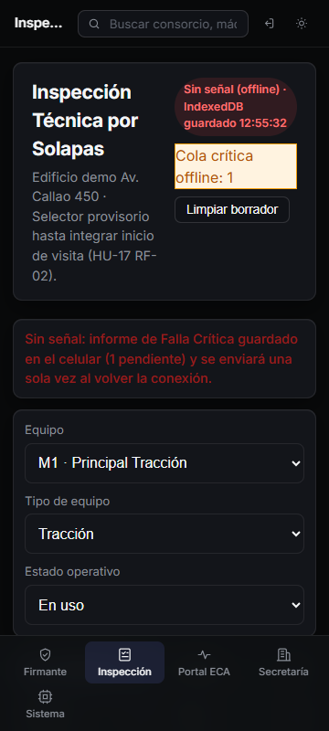
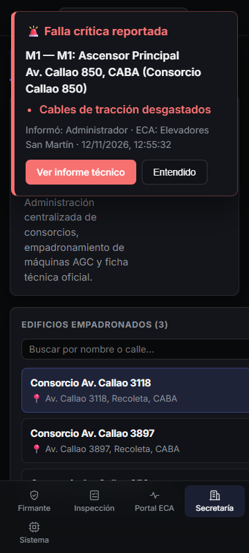

# Guía visual — HU-17 RF-08: Envío de Fallas Críticas y Cola Offline

Pantalla móvil (`360×800`) verificando el despacho de fallas críticas desde el checklist por solapas: resguardo offline en IndexedDB (`cola_fallas_criticas`), sincronización automática única al recuperar señal y alerta en Secretaría y Firmante.

## Paso 1 — Falla crítica con foto guardada sin señal en cola offline

Sin conexión, al presionar **"Guardar Sala de Máquinas"** sobre un hallazgo crítico (`cables_traccion-desgastados` con fotografía adjunta), el informe queda en la cola de IndexedDB con su `clientReportId` y se muestra la insignia **"Cola crítica offline: 1"**.

## Paso 2 — Alerta recibida en Secretaría y Firmante al recuperar la señal

Al restablecerse la conexión, la cola sincroniza una sola vez contra `POST /api/fallas-criticas/informes` (deduplicado en API por `clientReportId`), dispara el evento SSE `falla-critica` y aparece el aviso emergente en **Secretaría** y **Firmante**.

