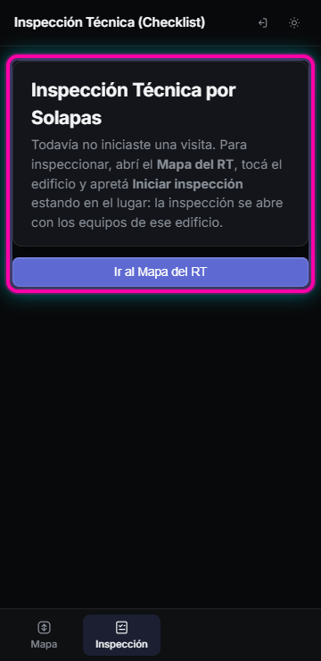
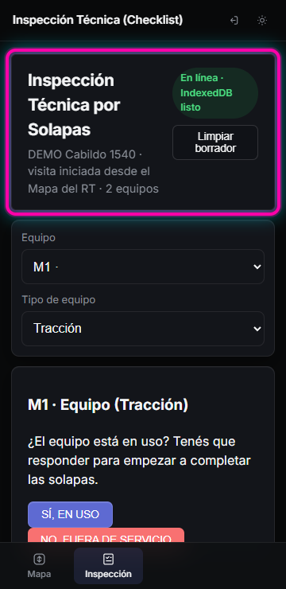
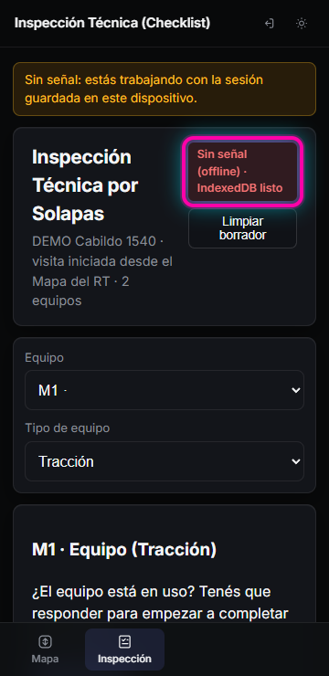

# HU-17 · RF-10 · Entrega — La Inspección Técnica arranca desde el inicio de visita

- **Tarea:** HU-17 / RF-10 — `REQ-1795263643622`
- **Script:** [RF-10-entrega.sh](RF-10-entrega.sh) · **Prueba en el navegador:** [RF-10-navegador.cjs](RF-10-navegador.cjs)
- **Archivos cambiados:** [`InspeccionCampoView.tsx`](../../../apps/web/src/checklist/InspeccionCampoView.tsx), [`navegacion.ts`](../../../apps/web/src/checklist/navegacion.ts), [`offlineStore.ts`](../../../apps/web/src/checklist/offlineStore.ts), [`App.tsx`](../../../apps/web/src/App.tsx), [`auth/sesion.ts`](../../../apps/web/src/auth/sesion.ts), la prueba nueva [`inspeccionDesdeVisita.test.ts`](../../../apps/web/src/checklist/inspeccionDesdeVisita.test.ts) y [`checklist.test.ts`](../../../apps/web/src/checklist/checklist.test.ts)

## 1. Qué quedó implementado

La pantalla de Inspección Técnica decía «Edificio demo Av. Callao 450 · Selector provisorio…». Si el RT la abría sin haber iniciado una visita, o si se recargaba la página, trabajaba sobre tres equipos de ejemplo. Iniciar la visita desde la tarjeta del Mapa del RT ya cargaba los equipos del edificio (HU-16 RF-02), pero cualquier falla de esa carga volvía a la demo.

**Ahora:**

- **Con la visita iniciada**, la inspección muestra el nombre del edificio y sus equipos, tomados de su ficha. Por ejemplo: «DEMO Cabildo 1540 · visita iniciada desde el Mapa del RT · 2 equipos».
- **Sin visita iniciada**, explica cómo iniciarla: «Abrí el Mapa del RT, tocá el edificio y apretá Iniciar inspección estando en el lugar». Además ofrece el botón **Ir al Mapa del RT**.
- Si se inició la visita pero no se pudieron traer los equipos (sin señal, o una ficha sin máquinas), lo dice, en lugar de mostrar un edificio inventado.
- **El edificio de demo y el selector provisorio ya no existen** en la app. Los tres equipos de ejemplo quedaron sólo como datos de prueba en `checklist.test.ts`.
- **El borrador sin señal sigue andando por edificio y máquina.**
  - El edificio en inspección queda guardado en el celular, así que recargar la página (con o sin señal) no lo pierde. Se borra al cerrar sesión, y otro usuario no lo ve.
  - El borrador de la inspección ahora guarda de qué edificio es. Sólo se restaura en ese edificio y si la máquina existe, así que no se mezcla con otra visita.

## 2. Cómo se levanta y se prueba

```bash
npm run db:up && npm run dev                                   # API
bash docs/pruebas/hu-04-hu-04-semaforo-de-control-mens/RF-02-datos-demo.sh
npm run build -w apps/web && npm run preview -w apps/web        # web compilada en https://localhost:4173
bash docs/pruebas/hu-17-hu-17-inspeccion-tecnica-por-s/RF-10-entrega.sh
```

La prueba del navegador simula que el celular está en «DEMO Cabildo 1540», para que el mapa habilite «Iniciar Inspección». Registra un inicio de inspección de `rt.beto` en ese edificio, como haría el RT en la calle.

## 3. Qué datos hacen falta

Los datos de demo de HU-04 RF-02: `rt.beto`, clave `Demo-Clave-2026`, con «DEMO Cabildo 1540» y sus máquinas M1 y M2.

## 4. Qué endpoints o pantallas toca

Ningún endpoint. Pantallas: la Inspección Técnica del RT, y el paso del Mapa del RT a la inspección.

## 5. Cómo se corre integrado

Resultado del 21/11/2026, en Chrome con Playwright a 360 × 740:

| Condición | Resultado |
|---|---|
| 1. Con la visita iniciada, ve las máquinas de ese edificio | Al iniciar la visita en «DEMO Cabildo 1540», la inspección es de ese edificio, con M1 y M2 |
| 2. Sin visita, un mensaje explica cómo iniciarla | «Todavía no iniciaste una visita. Para inspeccionar, abrí el Mapa del RT, tocá el edificio y apretá Iniciar inspección…», con «Ir al Mapa del RT» |
| 3. El selector provisorio y el edificio de demo ya no existen | Ninguna referencia en el código de la app, y nada de eso en pantalla |
| 4. El borrador sin señal sigue por edificio y máquina; las pruebas del checklist en verde | Recargando con y sin señal sigue en «DEMO Cabildo 1540». Pruebas del checklist y del edificio en inspección: 87/87 |

`RF-10-entrega.sh`: 5 bien, 0 mal, 0 omitidos (con 6 comprobaciones en el navegador). La web completa: 621/621.

## Guía visual

Usuario `rt.beto`, en un celular de 360 px. Capturas sacadas con `RF-10-navegador.cjs`.

### Paso 1 · Sin visita iniciada

Tocá **Inspección** en la barra de abajo antes de iniciar ninguna visita.



**Qué tenés que ver:** el texto que explica cómo iniciar la visita y el botón **Ir al Mapa del RT**. Ningún edificio de ejemplo.

### Paso 2 · Con la visita iniciada

En el mapa, tocá «DEMO Cabildo 1540», apretá **Verificar ubicación** y después **Iniciar Inspección**.



**Qué tenés que ver:** «DEMO Cabildo 1540 · visita iniciada desde el Mapa del RT · 2 equipos». En el selector de equipos aparecen M1 y M2.

### Paso 3 · Recargar sin señal

Cortá la señal y recargá la página.



**Qué tenés que ver:** la inspección sigue en «DEMO Cabildo 1540», con el aviso «Sin señal (offline)».

## Supuestos y límites

- **«Iniciar la visita» es lo de HU-16 RF-02:** la tarjeta del edificio en el Mapa del RT, con la validación de presencia. Esta Tarea no cambia esa validación.
- El edificio en inspección queda guardado hasta que el RT inicia otra visita o cierra sesión. Terminar la inspección no lo borra, porque el informe se cierra en otra pantalla (HU-18).
- Un borrador guardado antes de esta versión no dice de qué edificio es: se restaura sólo si su máquina existe en el edificio actual.
