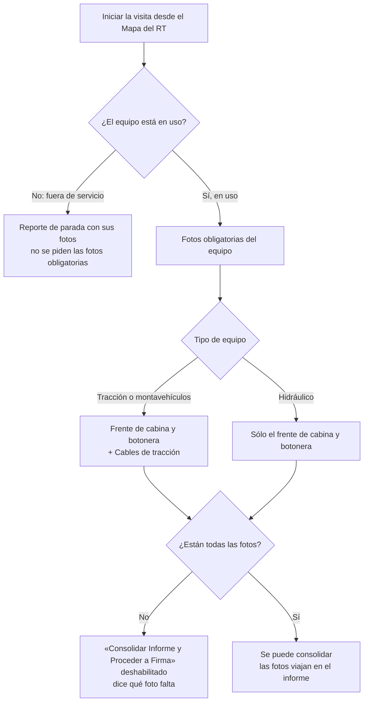
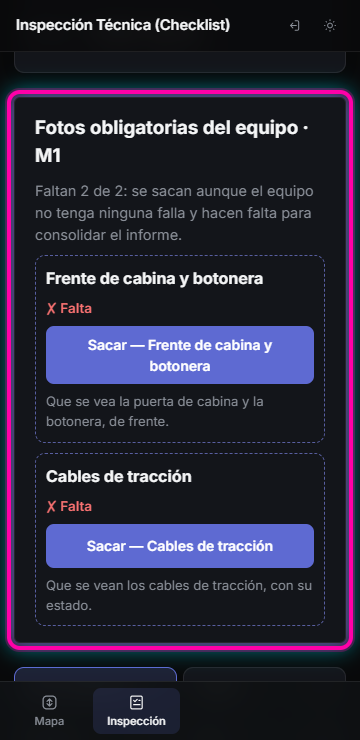
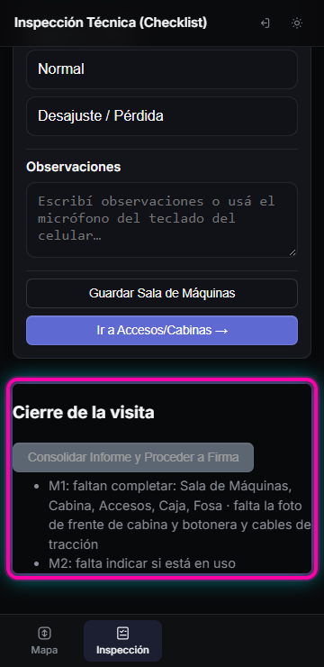
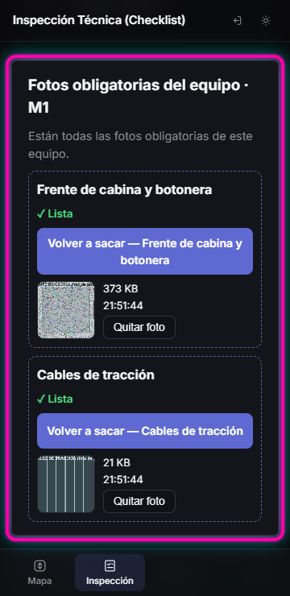
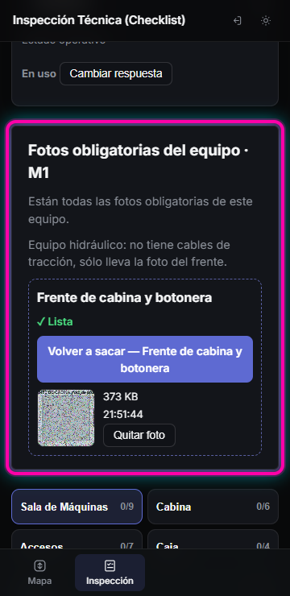
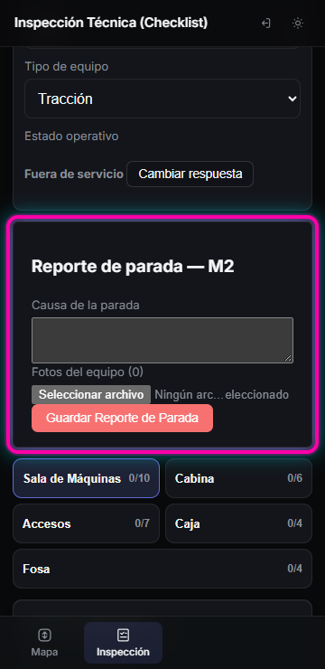
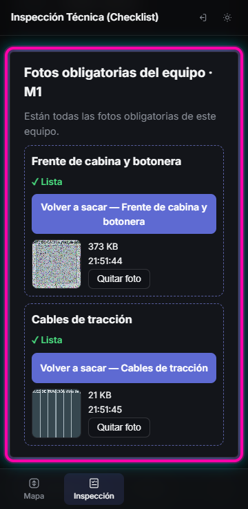
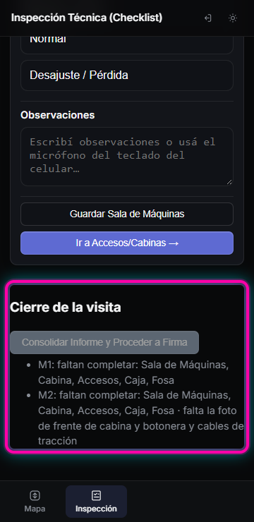

# HU-17 · RF-11 · Guía visual — Fotos obligatorias del frente de cabina y de los cables

Recorrido para quien nunca vio la pantalla: cómo el RT saca, en cada equipo en uso, la foto del frente de cabina y (si tiene cables de tracción) la de cables, y qué pasa si falta alguna.

- **Usuario:** `rt.beto` / `Demo-Clave-2026` (datos de demo de HU-04 RF-02), en un celular de 360 px.
- **Edificio:** «DEMO Cabildo 1540», con los equipos M1 y M2.
- **Capturas:** sacadas con [RF-11-navegador.cjs](RF-11-navegador.cjs) (Playwright). Las fotos son imágenes dibujadas en el momento, con el rótulo «foto de prueba»: en el navegador automatizado no hay cámara.
- **Entrega y script:** [RF-11-entrega.md](RF-11-entrega.md) · [RF-11-entrega.sh](RF-11-entrega.sh)

## Paso 1 · El equipo está en uso: aparecen las fotos obligatorias

En **Inspección**, con la visita iniciada, elegí el equipo **M1** (tipo **Tracción**) y tocá **SÍ, EN USO**.

**Qué tenés que ver:** la tarjeta **Fotos obligatorias del equipo · M1**, con «Faltan 2 de 2» y dos recuadros, **Frente de cabina y botonera** y **Cables de tracción**, cada uno con **✗ Falta** y su botón **Sacar**. Se piden aunque el equipo no tenga ninguna falla.

## Paso 2 · Sin las fotos no se puede consolidar

Bajá hasta **Cierre de la visita**.

**Qué tenés que ver:** el botón **Consolidar Informe y Proceder a Firma** deshabilitado y, en la lista de pendientes, la línea de **M1** con lo que falta de las solapas **y** «falta la foto de frente de cabina y botonera y cables de tracción». Una sola línea por equipo.

## Paso 3 · Sacar las fotos

Volvé a la tarjeta y tocá **Sacar — Frente de cabina y botonera**; en el celular se abre la cámara. Después **Sacar — Cables de tracción**.

**Qué tenés que ver:** «Están todas las fotos obligatorias de este equipo», las dos con **✓ Lista**, su miniatura, el tamaño y la hora en que se sacó. Cada foto se comprime a **500 KB o menos**: la de prueba pesaba unos 4,9 MB y quedó en 373 KB. El botón pasa a **Volver a sacar** y está **Quitar foto**: al quitarla, vuelve a figurar **✗ Falta** y el pendiente de «Consolidar» lo dice de nuevo.

## Paso 4 · Un equipo hidráulico no tiene cables

Con las fotos sacadas, cambiá **Tipo de equipo** a **Hidráulico**.

**Qué tenés que ver:** sólo el recuadro del frente y el aviso **«Equipo hidráulico: no tiene cables de tracción, sólo lleva la foto del frente»**. La foto de cables deja de exigirse y, si ya estaba sacada, no viaja en el informe. Al volver a **Tracción** se vuelve a pedir (y la foto sacada sigue ahí).

## Paso 5 · Un equipo fuera de servicio no las necesita

Elegí el equipo **M2** y tocá **NO, FUERA DE SERVICIO**.

**Qué tenés que ver:** el **Reporte de parada — M2** con su causa y sus fotos, y **ninguna** tarjeta de fotos obligatorias. Si tocás **Cambiar respuesta** y lo ponés **SÍ, EN USO**, se le piden las dos.

## Paso 6 · Sin señal, las fotos siguen ahí

Cortá la conexión (modo avión) y recargá la página. Entrá a **Inspección** y elegí **M1**.

**Qué tenés que ver:** la visita recuperada y las dos fotos de **M1** con **✓ Lista**: se guardan en el celular con el resto del borrador.

## Paso 7 · El pendiente se actualiza

Bajá a **Cierre de la visita**.

**Qué tenés que ver:** la línea de **M1** ya no habla de fotos: queda lo que falta de las solapas. La de **M2** sí: volvió a ponerse en uso en el paso 5 y todavía no tiene las suyas. Cuando todas las solapas estén completas y cada equipo en uso tenga sus fotos, el botón **Consolidar Informe y Proceder a Firma** se habilita y el informe las lleva.
