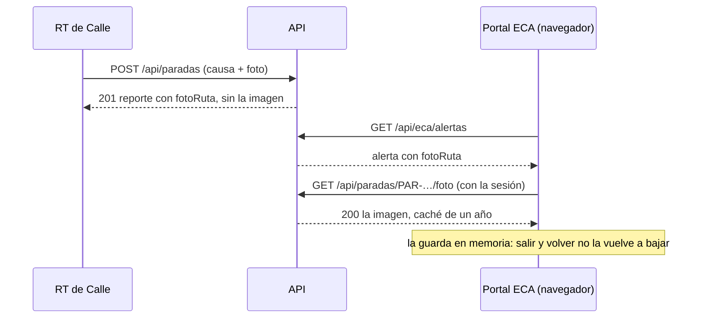
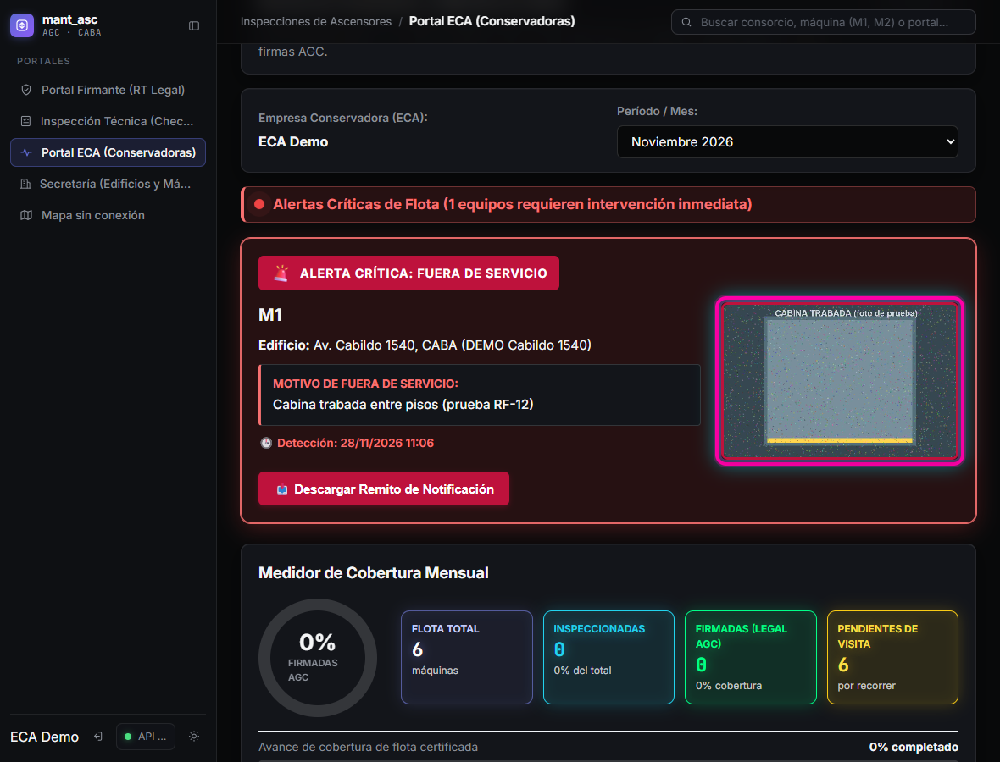
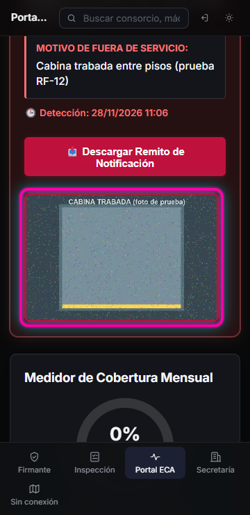

# HU-17 · RF-12 · Guía visual — La foto de una parada, pedida aparte

Recorrido para quien nunca vio esto: cómo se ve la foto de un equipo fuera de servicio en el Portal ECA ahora que la lista de reportes ya no la lleva adentro.

- **Usuarios:** `rt.beto` (carga el reporte), `demo.eca` (mira la alerta) y `demo.firmante` (cierra la prueba), clave `Demo-Clave-2026`, datos de demo de HU-04 RF-02.
- **Edificio y equipo:** «DEMO Cabildo 1540», M1.
- **Capturas:** sacadas con [RF-12-navegador.cjs](RF-12-navegador.cjs) (Playwright). La foto es una imagen dibujada en el momento, con el rótulo «foto de prueba»: en el navegador automatizado no hay cámara.
- **Entrega y script:** [RF-12-entrega.md](RF-12-entrega.md) · [RF-12-entrega.sh](RF-12-entrega.sh)



## Paso 1 · Cargar el reporte (por API)

Como RT, `POST /api/paradas` con la causa y la foto. La respuesta **ya no repite la imagen**: trae la ruta para pedirla.

```json
201 { "id": "PAR-…", "maquinaId": "MAQ-…", "codigoAGC": "M1", "edificio": "DEMO Cabildo 1540",
      "estadoMarcado": "Fuera de Servicio", "causa": "Cabina trabada entre pisos",
      "fotos": 1, "fotoRuta": "/api/paradas/PAR-…/foto", "confirmacion": "Pendiente de confirmación", … }
```

La lista de la Secretaría (`GET /api/paradas`) trae lo mismo, sin `fotoUrl`: pesa unos 700 bytes por reporte, con una foto de 74 KB.

## Paso 2 · La ECA mira su alerta

Entrá como `demo.eca` al **Portal ECA (Conservadoras)**.



**Qué tenés que ver:** la tarjeta **ALERTA CRÍTICA: FUERA DE SERVICIO** de **M1 · DEMO Cabildo 1540**, con el motivo, **Descargar Remito de Notificación** y, a la derecha, **la foto de la cabina**. Mientras se baja aparece «Cargando foto…» un instante.

Por debajo, la pantalla pidió `GET /api/paradas/PAR-…/foto` **una sola vez**, con la sesión. Si abrís **DevTools › Network**, ves un único pedido con el encabezado `Authorization` y, en la respuesta, `Content-Type: image/jpeg` y `Cache-Control: private, max-age=31536000, immutable`. Si cambiás a **Firmante** y volvés a **Portal ECA**, la foto aparece de nuevo **sin otro pedido**.

Quien no tiene sesión recibe **401**; un Firmante de otro edificio o una ECA de otra empresa, **404**.

## Paso 3 · En un celular

Con el mismo usuario, en una pantalla de 360 px.



**Qué tenés que ver:** la misma alerta, con la foto a todo el ancho de la pantalla y sin cortarse.

## Paso 4 · Cerrar la prueba

El Firmante (`demo.firmante`) rechaza el reporte con `POST /api/paradas/<id>/rechazar` y un motivo: el equipo vuelve a **Normal** y la alerta desaparece del Portal ECA. El script lo hace solo.
