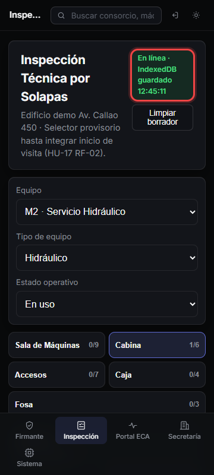
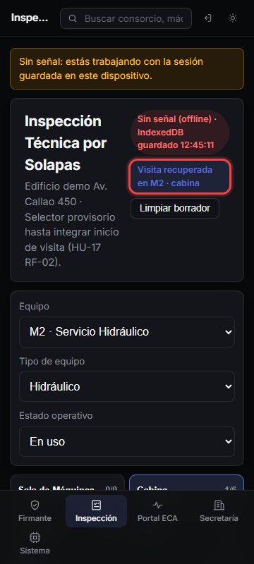

# Guía visual — HU-17 RNF-01: Modo Offline Completo (IndexedDB + PWA)

Flujo móvil (`360×800`) verificando almacenamiento inmediato en **IndexedDB** (`mant_asc_inspeccion_db`) y reapertura de la aplicación sin red (`context.setOffline(true)`).

## Paso 1 — Persistencia inmediata en IndexedDB (cero LocalStorage)

Al responder ítems o adjuntar fotos, el estado completo de equipos, solapas y respuestas se guarda en IndexedDB (`visitas_en_curso`), sin guardar respuestas ni fotos en `LocalStorage`.

## Paso 2 — Reapertura sin señal en el mismo equipo y solapa

Tras cerrar la pestaña, cortar la red y volver a abrir la app desde la caché Workbox del Service Worker, la inspección reabre directo en **`M2 · cabina`** recuperando respuestas y observaciones.

