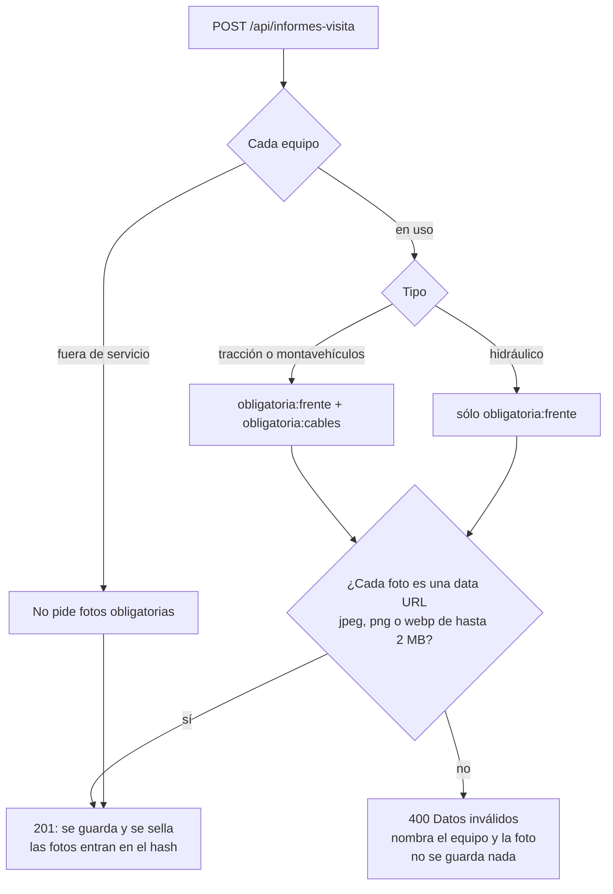

# HU-18 · RF-02 — El informe cerrado exige y sella las fotos obligatorias

**Qué hace.** Cuando el RT cierra el informe (`POST /api/informes-visita`), la API controla que **cada equipo en uso** traiga la foto del **frente de cabina y botonera** y, si tiene cables de tracción, la de los **cables**. Si falta alguna, rechaza el informe con **400** y **no guarda nada**. Las fotos quedan dentro del contenido sellado (SHA-256, HU-18 RNF-01): cambiar una después de cerrado invalida el sello.

Es la contraparte de la API de HU-17 RF-11, que hace sacar las fotos en el celular. La API las exige igual porque la auditoría no puede depender de que el celular lo haga bien: una versión vieja de la app o un envío armado a mano no se cuelan.

- **Entrega y script:** [RF-02-entrega.md](RF-02-entrega.md) · [RF-02-entrega.sh](RF-02-entrega.sh)
- **Es una tarea de API:** no cambia ninguna pantalla, así que esta guía es un recorrido por la API, con las respuestas reales, y no tiene capturas.



## Qué exige

| Equipo | Fotos obligatorias | Claves en `fotos` del equipo |
|---|---|---|
| En uso, **tracción** o **montavehículos** | Frente de cabina y botonera + cables de tracción | `obligatoria:frente` y `obligatoria:cables` |
| En uso, **hidráulico** | Sólo el frente (no tiene cables de tracción) | `obligatoria:frente` |
| **Fuera de servicio** | Ninguna (lleva su reporte de parada con fotos) | — |

Cada foto es un objeto con `dataUrl`: una imagen **jpeg, png o webp** en data URL, de **hasta 2.000.000 caracteres**. Las fotos de anomalía (`solapa:ítem`) siguen igual y **no reemplazan** a las obligatorias.

## Paso a paso (por API)

Con `npm run db:up`, la API levantada y los datos de demo (`RF-02-datos-demo.sh` de HU-04). Un RT inicia sesión con `POST /api/auth/login` y manda `Authorization: Bearer <token>`.

### 1. Un equipo en uso sin la foto del frente

```http
POST /api/informes-visita
{ "consorcioId": "…", "horaDispositivo": "2026-11-23T15:30:00Z",
  "equipos": [{ "maquinaId": "m1", "referenciaAgc": "M1", "tipo": "traccion", "estadoEquipo": "en_uso",
                "respuestas": {…}, "observaciones": {}, "fotos": {} }],
  "firma": { … } }
```

```json
400 { "message": "Datos inválidos", "errores": [
  "El equipo M1 (equipos[0]) no trae la foto de frente de cabina y botonera (obligatoria:frente): se saca en cada equipo en uso, aunque no haya fallas",
  "El equipo M1 (equipos[0]) no trae la foto de cables de tracción (obligatoria:cables): se saca en cada equipo en uso, aunque no haya fallas" ] }
```

Dice **qué equipo** y **qué foto**, una línea por foto que falta. **No queda ninguna fila** en `informes_visita`. Con varios equipos, cada uno dice lo suyo (`equipos[1]`, `equipos[2]`…).

### 2. Tracción con el frente pero sin cables, y el hidráulico

- Tracción o montavehículos con `obligatoria:frente` y sin `obligatoria:cables` → **400**, sólo por los cables.
- Hidráulico con sólo `obligatoria:frente` → **201**. Hidráulico sin el frente → **400**: el frente se pide siempre.

### 3. Una foto que no es una imagen

```json
400 { "message": "Datos inválidos", "errores": [
  "El equipo M1 (equipos[0]): la foto de frente de cabina y botonera (obligatoria:frente) tiene que ser una imagen en data URL (jpeg, png o webp) de hasta 2 MB" ] }
```

Se rechaza un texto cualquiera, otro tipo de archivo (`data:text/html…`, `data:image/gif…`), una data URL vacía o rota, y una foto sin `dataUrl`. Con **2.000.000** caracteres entra; con **uno más**, no.

### 4. Un equipo fuera de servicio

Con `"estadoEquipo": "fuera_de_servicio"` y `"fotos": {}` → **201**.

### 5. Las fotos quedan selladas

Un informe de tracción con las dos fotos → **201** con su `hashSha256`. Las fotos quedan en el contenido guardado y forman parte del hash: `POST /api/informes-visita/:id/verificar` (Secretaría o Administrador) da `coincide: true`; si alguien cambia la foto del frente directamente en la base, da `coincide: false`.

### 6. Los informes anteriores

La regla se aplica **sólo al cerrar**. Un informe guardado antes de esta tarea, sin fotos obligatorias, se sigue leyendo (`GET /api/informes-visita/:id`), listando y verificando (`coincide: true`).

## Cómo probarlo

```bash
npm run db:up && npm run dev
bash docs/pruebas/hu-04-hu-04-semaforo-de-control-mens/RF-02-datos-demo.sh
bash docs/pruebas/hu-18-hu-18-cierre-firma-y-envio-del/RF-02-entrega.sh
bash docs/pruebas/hu-18-hu-18-cierre-firma-y-envio-del/RF-02-entrega.sh --carga 50
```

Pruebas automáticas: `informes.spec.ts` (la validación, caso por caso), `informes-sellado.spec.ts` (el sello y los informes anteriores), `informes.e2e-spec.ts` (HTTP) y `informes.int-spec.ts` (PostgreSQL real, `npm run test:int`).

## Supuestos y limitaciones

- **La decisión es de German (23/11/2026) y falta confirmarla con MAICON.** Las claves y las reglas están en `informes.types.ts` e `informes.logic.ts`.
- **La API se fija en que haya una imagen, no en que la foto sea del frente o de los cables.** Una foto cualquiera con la clave correcta pasa. Eso se audita mirándola, con el sello que impide cambiarla después.
- **Un hidráulico no manda la de cables**; si el celular la manda igual (el RT la sacó antes de cambiar el tipo), la API la acepta y la guarda sin exigirla.
- **Cambia el formato del informe de prueba:** los tests y los scripts de entrega de HU-18 (RF-01, RNF-01 y RNF-02) que arman informes ahora mandan las fotos.
- Hasta que se mergee **HU-17 RF-11**, la pantalla del RT todavía no hace sacar estas fotos: con sólo este cambio en `dev`, el RT no podría cerrar un informe desde la app. **Se mergea después de RF-11.**
