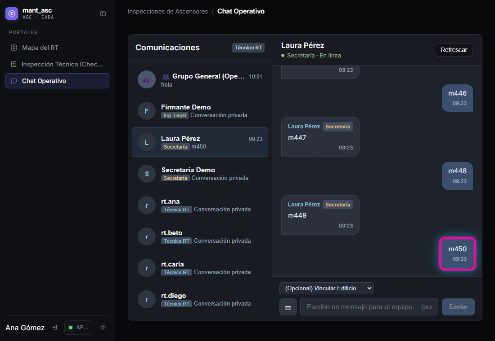
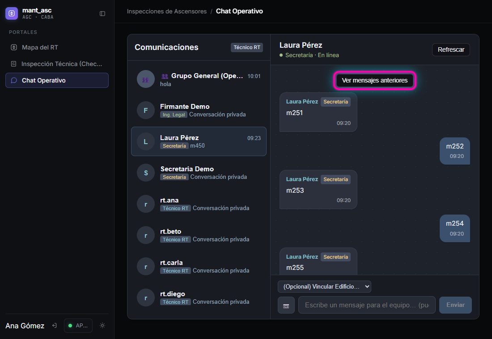
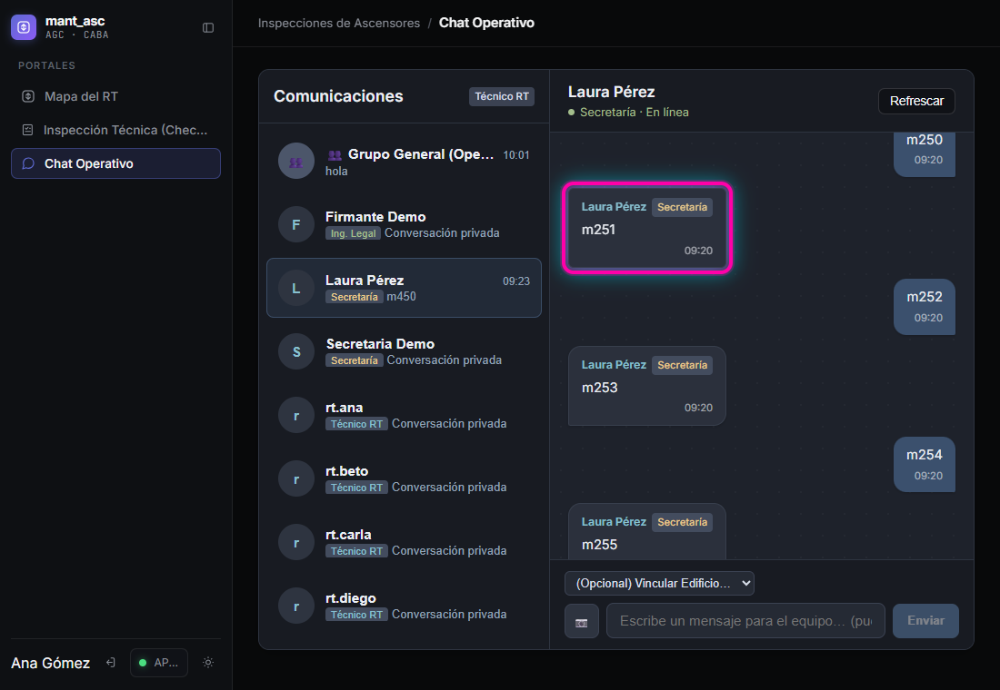
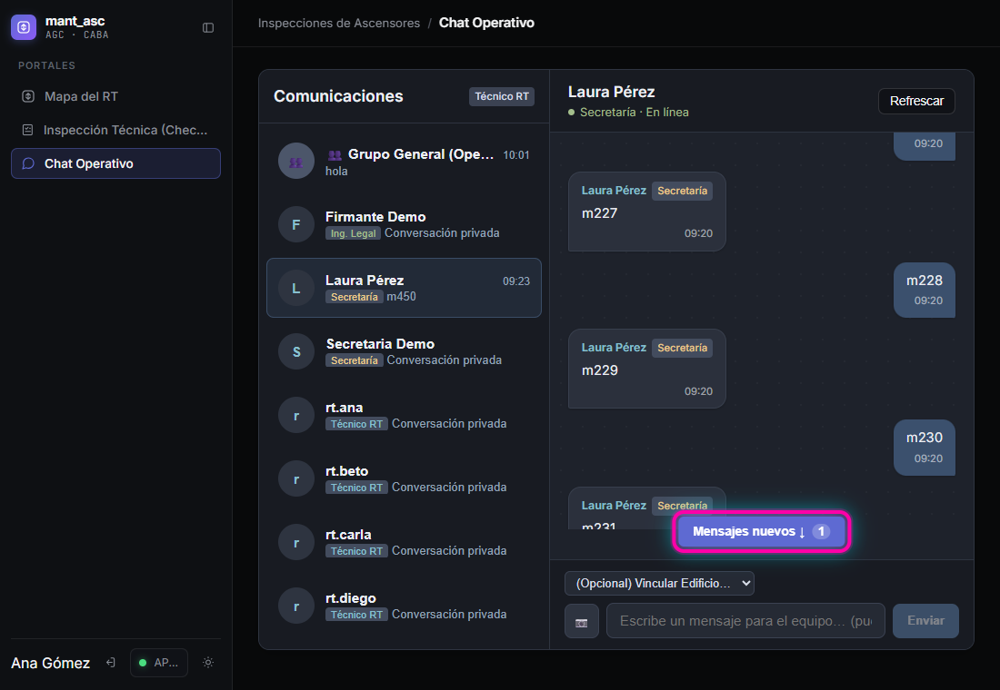
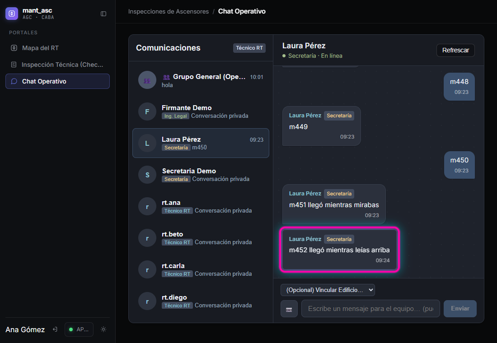

# HU-19 · RF-02 — El hilo del chat muestra siempre los mensajes más nuevos y deja leer los anteriores

**Historia de Usuario:** HU-19: Chat interno entre operarios e ingenieros para consultas y reportes
**Requerimiento:** RF-02 (`REQ-1795778246174`)
**Tipo:** Funcional. Sale de la revisión del chat del 25/11/2026 (pedido del usuario: «fijate el estado del chat… ¿tiene errores?»).

## El problema

Dos fallas del hilo, las dos probadas en pantalla:

1. **El grupo se congelaba a los 200 mensajes.** El chat pedía los 200 mensajes **más viejos** de cada conversación (orden ascendente con límite 200). Al pasar los 200, los mensajes nuevos se guardaban pero dejaban de verse **para todos**, mientras la lista de chats seguía mostrándolos como «último mensaje». Probado: con 210 mensajes el hilo quedó clavado en el 187.
2. **No se podían leer mensajes anteriores.** Cada 3,5 segundos la actualización automática llevaba el hilo al final: se pasó de arriba a abajo en menos de 8 segundos.

## Qué cambia

| | Antes | Ahora |
|---|---|---|
| Qué trae el hilo | Los 200 mensajes más viejos | Los **200 más nuevos**, de más viejo a más nuevo |
| Mensajes anteriores | Inalcanzables | Botón **«Ver mensajes anteriores»**: trae los 200 previos y los pone arriba sin mover lo que se está leyendo; desaparece cuando no quedan más |
| La actualización automática | Reemplazaba todo y bajaba siempre al final | **Junta** lo que llega con lo que ya se ve y solo baja si se estaba al final |
| Un mensaje nuevo mientras se lee más arriba | Te llevaba al final | El hilo no se mueve y aparece el aviso **«Mensajes nuevos ↓»** con la cantidad; al tocarlo baja |
| El último mensaje del hilo y el de la lista de chats | Podían ser distintos | Son siempre el mismo (los dos se ordenan por fecha y, si empatan, por identificador) |

Detalles del código:

- **API:** `GET /api/chat/mensajes?sala=…` sigue devolviendo una **lista** (no cambia el formato) con los 200 más nuevos. Acepta `antes=<id del mensaje más viejo que se ve>` para pedir los anteriores y `limite` (1 a 200). Si quedan mensajes anteriores lo dice el encabezado **`X-Hay-Anteriores`** (`true`/`false`; se pide un mensaje de más para saberlo con exactitud: con exactamente 200 no avisa). Un `antes` que no es un identificador o un `limite` fuera de rango responden **400**.
- **`chat/hilo.ts`** (web): las reglas del hilo como funciones puras: `fusionarVentana` (junta la actualización con lo ya cargado y devuelve la **misma** lista si no cambió nada), `sumarAnteriores`, `sumarPropio` y `estaAlFinal` (a 80 px del final o menos se considera «al final»).
- **`ChatOperativoView.tsx`:** el hilo baja solo al abrir la conversación, al enviar un mensaje propio, o si ya se estaba al final; al sumar anteriores compensa la altura para que lo que se leía no se mueva; una respuesta que llega de otra conversación (se cambió mientras tanto) se descarta; al cargarse una foto el hilo sigue al final si se estaba al final.

## Cómo probarlo

```bash
npm run db:up                                   # la base
npm run dev                                     # la API y la web
bash docs/pruebas/hu-19-hu-19-chat-interno-entre-opera/RF-02-entrega.sh
```

Da **17 verificaciones OK**; contra el estado anterior, 4 OK y 13 errores. Crea tres usuarios temporales, 450 mensajes privados y 210 en el grupo, y los borra al terminar. Comprueba por la API real: los 200 más nuevos y en orden (privado y grupo), que Beto vea lo mismo que Ana, que un mensaje enviado con más de 200 aparezca al final, que el último de la lista de chats sea el del final del hilo, las tres páginas de anteriores (200, 200 y 51) que juntas son los 451 mensajes sin repetir ni saltear ninguno, que con exactamente 200 no avise de anteriores, los pedidos inválidos con 400 y que el Firmante no vea una conversación ajena.

**La pantalla (criterios 4 y 5), a mano** — con la web levantada, dos usuarios (por ejemplo un RT y la Secretaría) y una conversación de más de 200 mensajes (el script crea una igual, o se pueden insertar en la base):

1. Ingresar como **Técnico RT** → **Chat Operativo** → la conversación larga. Se ven los 200 más nuevos y el hilo está al final; la lista de chats muestra el mismo último mensaje.

   

2. Subir hasta arriba del hilo: aparece **«Ver mensajes anteriores»**.

   

3. Tocarlo: se suman los 200 anteriores arriba y **el mensaje que se estaba leyendo (m251) queda en el mismo lugar de la pantalla**. El botón sigue mientras queden más viejos y desaparece al traer los últimos.

   

4. Dejar el hilo a mitad de camino y esperar más de 7 segundos: **no se mueve**. Que la otra persona (la Secretaría) escriba: el hilo sigue donde estaba y aparece **«Mensajes nuevos ↓»** con la cantidad.

   

5. Tocar el aviso: el hilo baja al final y el aviso desaparece. (También desaparece solo si se baja a mano. Si se estaba al final, el mensaje nuevo baja el hilo sin aviso, y enviar un mensaje propio siempre lo lleva al final.)

   

## Pruebas automáticas

| Archivo | Qué prueba |
|---|---|
| `api/test/chat-hilo.int-spec.ts` (10) | **Contra PostgreSQL de verdad**: los 200 más nuevos en un privado y en el grupo, un mensaje nuevo con más de 200, el último de la lista de chats (también con mensajes de la **misma fecha**, que se desempatan por id), las páginas de anteriores sin repetir ni saltear, exactamente 200, que lo anterior sea de la misma conversación y los pedidos inválidos |
| `api/test/chat-hilo.e2e-spec.ts` (12) | Por la API con sesiones: el cuerpo sigue siendo una lista, el encabezado `X-Hay-Anteriores` (y que se exponga), `antes`, `limite`, 7 pedidos inválidos con 400, 401 sin sesión y 403 a la ECA |
| `api/test/chat-hilo.spec.ts` (19) | El servicio: más de 200 en grupo y privado, el último de la lista, `hayAnteriores` en 200 y 201, tres páginas de anteriores, los límites y los 400 |
| `web/src/chat/hilo.test.ts` (23) | Las reglas del hilo (`estaAlFinal`, `fusionarVentana`, `sumarAnteriores`, `sumarPropio`) y las reglas de la pantalla |

**En un navegador real** (con 450 mensajes y una Secretaría escribiendo por la API mientras tanto) se comprobó lo que las pruebas de código no ven, **21 de 21**: se ven m251 a m450 y la lista dice m450; un mensaje nuevo llega solo y baja el hilo; el botón trae m51 a m250 y m251 queda a los mismos 243 px; la segunda vez trae m1 a m50 y el botón desaparece; leyendo a mitad de camino el hilo no se movió en 8 s; llega el aviso con la cantidad sin mover el hilo; tocarlo baja y lo quita; bajar a mano lo quita; enviar un mensaje propio baja; cambiar de conversación y volver empieza de cero, al final.

**Pruebas de mutación:** se rompió a propósito el código en 67 puntos (el orden y el desempate del SQL, el límite de uno de más, el `antes`, las validaciones, el encabezado, las reglas del hilo y de la pantalla) y **las 67 fueron detectadas** (en la primera pasada cuatro sobrevivieron y uno no compilaba; se reforzaron las pruebas y se cambió ese mutante por uno que compila).

**Suites completas:** API 1401 en verde; web 760 en verde y 1 fallo que no es de esta tarjeta (`fechas/formato.test.ts` por `toLocaleTimeString` en el chat: lo arregla HU-19 RF-08); integración 184 pasan y 37 fallan, las mismas que sin este cambio (alertas y máquinas de ejemplo que retiró HU-08 RF-06).

## Limitaciones

- La actualización automática sigue pidiendo los 200 más nuevos cada 3,5 segundos, con sus fotos adentro: el peso de eso es de HU-19 RF-05 (fotos livianas).
- Si falla el pedido de «Ver mensajes anteriores» (sin red), el botón queda para volver a tocarlo, pero no muestra un aviso del error: eso es de HU-19 RF-06.
- El aviso «Mensajes nuevos ↓» cuenta lo que llegó mientras se leía en esta pantalla; los contadores de no leídos entre conversaciones son de HU-19 RF-09.
- El comportamiento al desplazarse (criterios 4 y 5) se verificó en un navegador real pero no tiene prueba automática en el repositorio: la web se prueba sin navegador. Lo que sí tiene prueba son las reglas puras y el texto de la pantalla.
