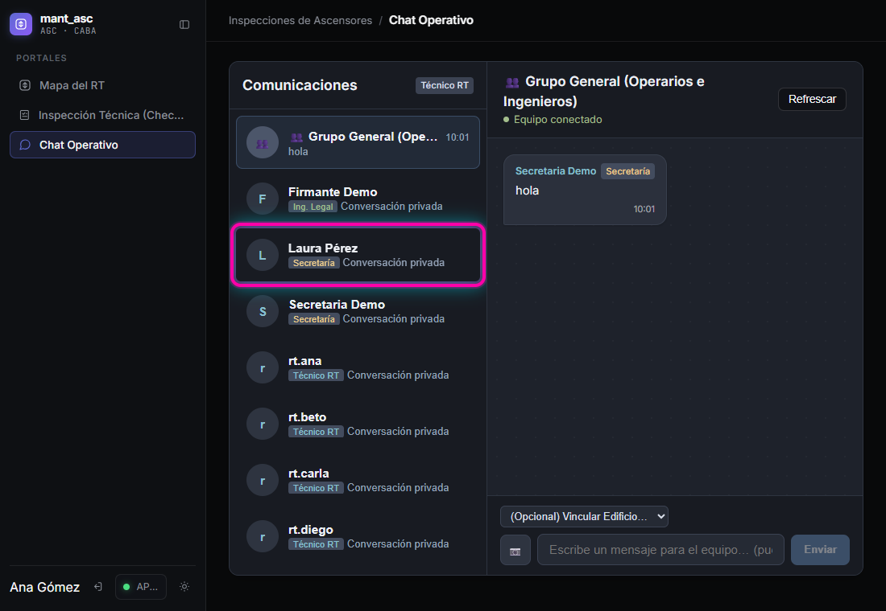
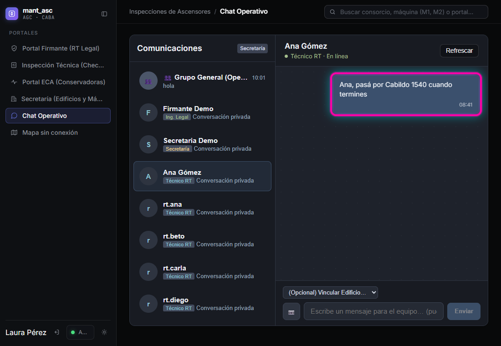
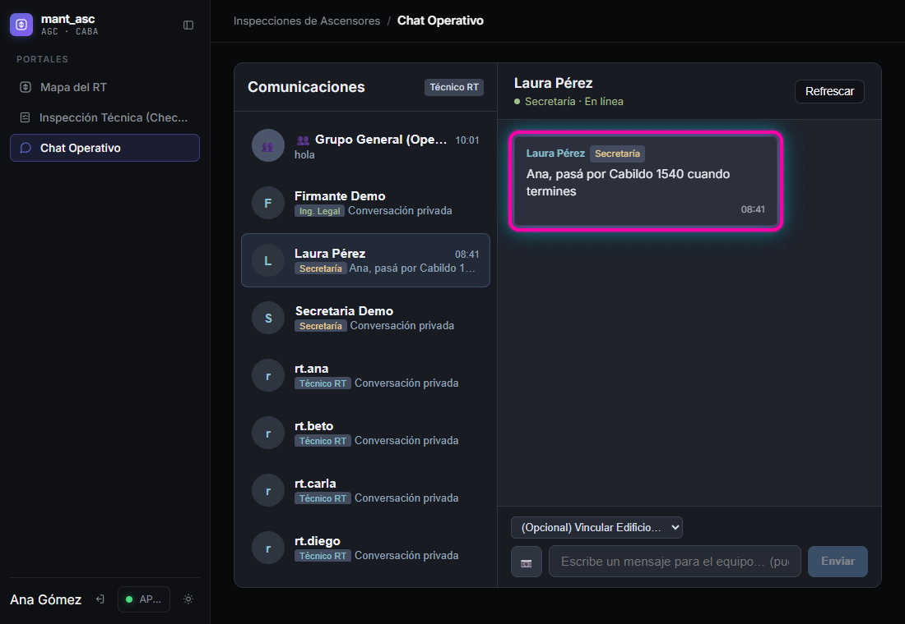
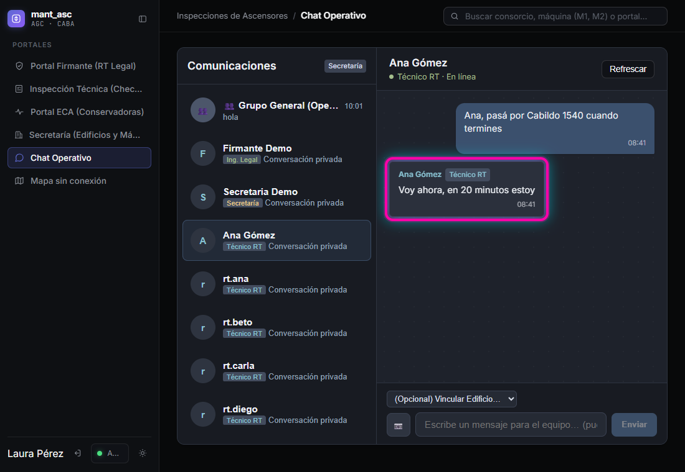
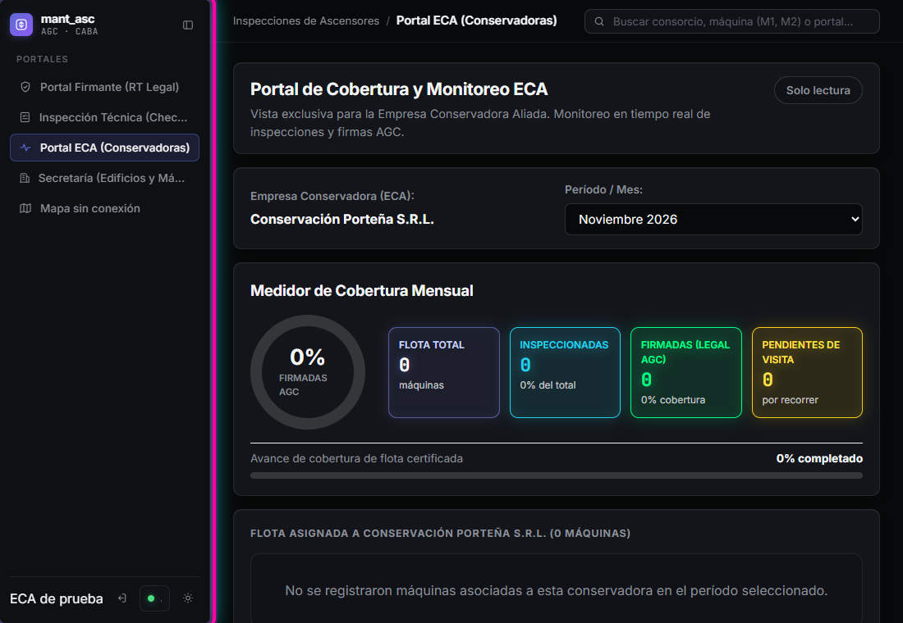

# HU-19 · RF-03 — La Secretaría figura como contacto en el chat y sus mensajes privados se pueden leer y responder

**Historia de Usuario:** HU-19: Chat interno entre operarios e ingenieros para consultas y reportes
**Requerimiento:** RF-03 (`REQ-1795778246351`)
**Tipo:** Funcional. Sale de la revisión del chat del 25/11/2026 (pedido del usuario: «fijate el estado del chat… ¿tiene errores?»).

## El problema

La Secretaría puede entrar al chat y escribirle por privado a cualquiera, pero **no figuraba en la lista de contactos de nadie**: la lista solo traía Técnicos RT, Firmantes y Administradores. Probado en pantalla con una Secretaría y un RT a la vez: el mensaje privado de la Secretaría al RT se guardaba, pero el RT **no tenía ese chat en su lista**, nunca lo veía y no podía contestar. Lo mismo al revés: ningún RT podía escribirle a la Secretaría.

## Qué cambia

| | Antes | Ahora |
|---|---|---|
| Contactos de un RT, un Firmante y un Administrador | Firmantes, RT y Administradores | **Más la Secretaría** |
| Contactos de la Secretaría | RT, Firmantes y Administradores (no se veía a sí misma) | Igual, y también ve a otra Secretaría si la hay; nunca a sí misma |
| Quién usa el chat y quién puede ser contacto | Dos listas escritas por separado (el controlador y la consulta de contactos) que se habían desfasado | **Una sola lista**, `ROLES_DEL_CHAT`, usada por las dos: la ECA queda afuera de las dos |
| Cómo se nombra a la Secretaría en pantalla | Se mostraba el valor interno «secretaria», en minúscula | Se muestra **«Secretaría»**, con su propio color de insignia |

Detalles del código:

- **`ROLES_DEL_CHAT`** (`api/src/chat/chat.repository.ts`): `rt_calle`, `firmante`, `administrador`, `secretaria`. La consulta de contactos arma su `rol IN (…)` desde esa lista y el controlador la pasa a `@Roles(...)`. Se ordena Firmante, Secretaría, Técnicos RT, Administradores.
- **`etiquetaDeRol`** (`web/src/chat/etiquetaRol.ts`): la etiqueta de cada rol, sacada del componente para poder probarla; la usan la insignia propia, la lista de conversaciones, la cabecera y cada mensaje.
- Lo que **no** cambia: los privados siguen viéndolos solo sus dos participantes (la consulta ya lo hacía; ahora hay pruebas que lo exigen también con la Secretaría), y la ECA sigue sin chat.

## Cómo probarlo

```bash
npm run db:up                                   # la base
npm run dev                                     # la API y la web
bash docs/pruebas/hu-19-hu-19-chat-interno-entre-opera/RF-03-entrega.sh
```

Da **14 verificaciones OK**; contra el estado anterior, 11 OK y 3 errores (los de la lista de contactos). Crea usuarios temporales (dos Secretarías, dos RT, un Firmante, un Administrador y una ECA) y los borra, con sus mensajes, al terminar. Comprueba por la API real: que el RT, el Firmante y el Administrador tengan a la Secretaría de contacto con su rol y su nombre, que ella no se vea a sí misma y sí a los demás, los privados en las dos direcciones (con el último mensaje en la lista), que Firmante, Administrador, otro RT y otra Secretaría no vean esos privados en ningún lado, y que la ECA reciba 403 en las tres rutas y no figure como contacto.

**La pantalla, a mano** (web levantada; usuarios de demostración o los que tengas, contraseña `Demo-Clave-2026`):

1. Ingresar como **Técnico RT** → **Chat Operativo**: en la lista de conversaciones figura la Secretaría, con la insignia **«Secretaría»**.

   

2. En otra ventana, ingresar como **Secretaría** → **Chat Operativo** → elegir al RT y escribirle. La Secretaría no se ve a sí misma en su lista.

   

3. Volver al RT y abrir otra vez el chat (la lista se carga al abrir la pantalla): la conversación con la Secretaría muestra el mensaje como último; al abrirla se lee completo.

   

4. El RT responde. La Secretaría lo recibe sola, sin recargar (la conversación abierta se actualiza cada 3,5 segundos).

   

5. Ingresar como **ECA**: el menú no tiene «Chat Operativo».

   

## Pruebas automáticas

| Archivo | Qué prueba |
|---|---|
| `api/test/chat-secretaria.int-spec.ts` (7) | **Contra PostgreSQL de verdad**: los cinco criterios y que una Secretaría dada de baja no figure |
| `api/test/chat-secretaria.e2e-spec.ts` (7) | Por la API con sesiones reales: los tres roles ven a la Secretaría, la Secretaría entra, el RT le escribe, la ECA recibe 403 en las tres rutas y sin sesión 401 |
| `api/test/chat-secretaria.spec.ts` (7) | El servicio: contactos con y sin la Secretaría, los privados en las dos direcciones, la privacidad y que `ROLES_DEL_CHAT` no incluya a la ECA |
| `web/src/chat/etiquetaRol.test.ts` (5) | La etiqueta de cada rol, y que la vista y el estilo de la insignia la usen |

**Pruebas de mutación:** se rompió a propósito el código en 27 puntos (los roles del chat, la consulta de contactos, el SQL de los privados, las etiquetas, el estilo) y **las 27 mutaciones fueron detectadas**.

**Suites completas:** API 1368 en verde; web 737 en verde y 1 fallo que no es de esta tarjeta (`fechas/formato.test.ts` por `toLocaleTimeString` en el chat: lo arregla HU-19 RF-08); integración 173 pasan y 37 fallan, las mismas que sin este cambio (alertas y máquinas de ejemplo que retiró HU-08 RF-06).

## Limitaciones

- La lista de conversaciones se carga una sola vez al abrir el chat: un contacto nuevo o un mensaje privado nuevo aparece al volver a abrir la pantalla, no al instante. Los contadores de no leídos y su actualización automática son de HU-19 RF-09.
- Los privados de la Secretaría con el RT dependen de que existan usuarios activos con ese rol; una Secretaría dada de baja deja de figurar.
