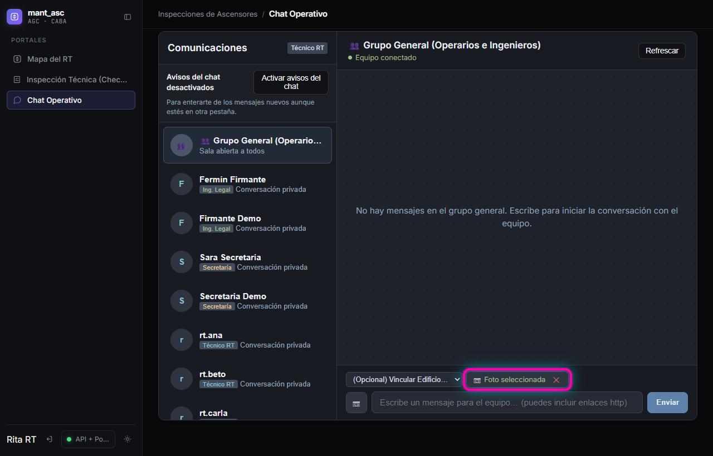
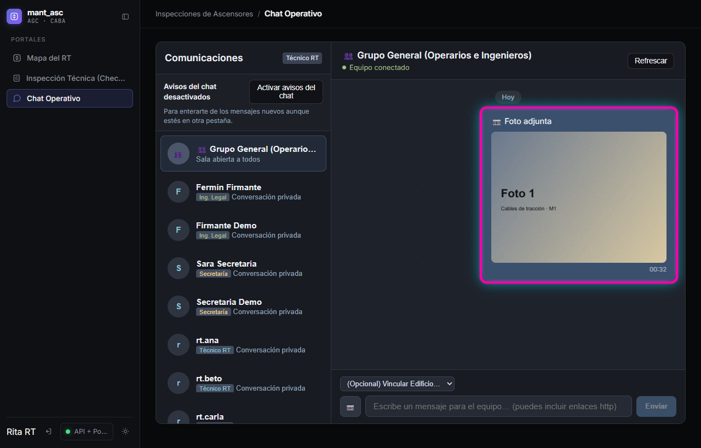
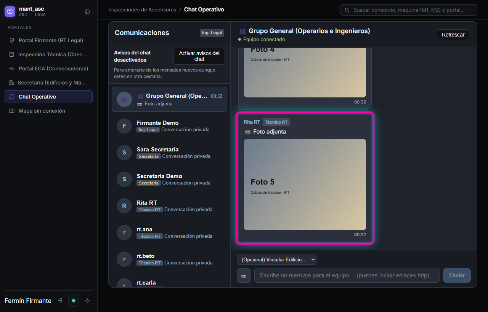
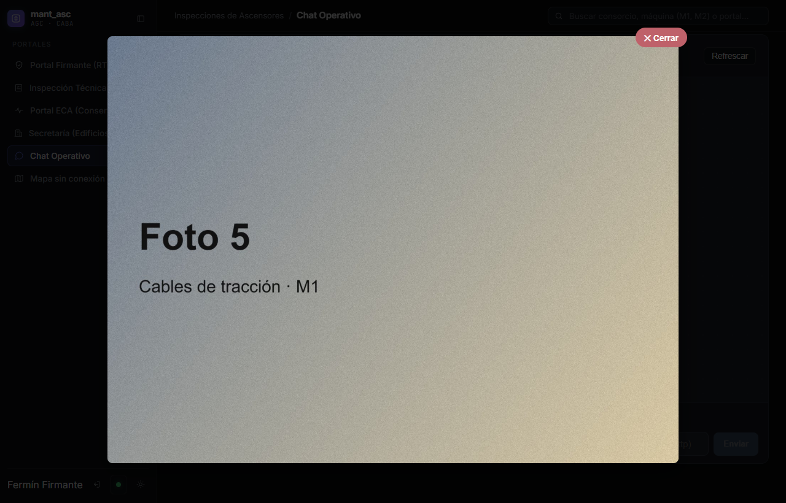
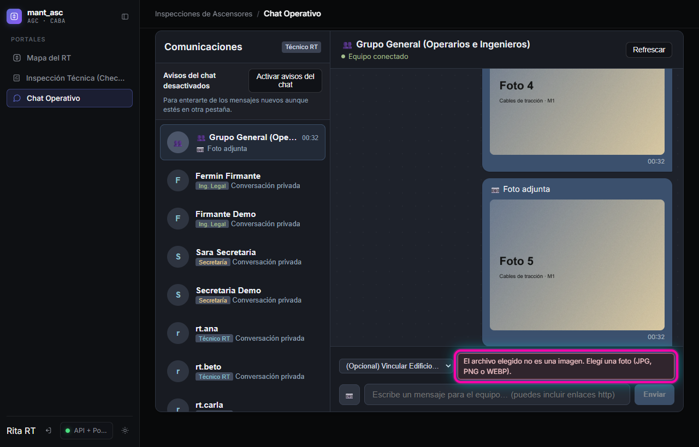

# HU-19 · RF-05 — Las fotos del chat son livianas: se reducen antes de enviarlas y la actualización del hilo no las vuelve a bajar

**Historia de Usuario:** HU-19: Chat interno entre operarios e ingenieros para consultas y reportes
**Requerimiento:** RF-05 (`REQ-1795778246661`)
**Tipo:** Funcional. Depende de RF-04 (la validación de la API del chat), porque fija el formato y el tope de los adjuntos.

## El problema

La foto se mandaba tal como la saca el celular y viajaba **dentro de cada mensaje**, en base64. Además, cada usuario pide el hilo completo cada 3,5 segundos. Con una sola foto de 8 MB, **cada actualización del hilo bajaba 8,1 MB por usuario**: con unas pocas fotos, el chat era inusable con datos móviles.

## Qué cambia

| | Antes | Ahora |
|---|---|---|
| La foto que se envía | Tal como sale del celular (4000 × 3000, 5 a 8 MB) | **Reducida en el celular**: lado mayor de **1.600 px**, en **JPEG**, **menos de 500 KB** (medido: una foto de 6,9 MB salió en 310 KB, 1600 × 1200) |
| El hilo | Traía cada foto entera, en cada actualización | Trae solo la **ruta** de la foto (`/api/chat/mensajes/<id>/foto`). Con 5 fotos, cada actualización pesa **2 KB** |
| La foto | — | Se pide **aparte y una sola vez**: la pantalla la guarda en memoria y el navegador la guarda un año (`Cache-Control: private, max-age=31536000, immutable`) |
| Quién puede pedir la foto | — | Solo quien puede leer el mensaje: del grupo, los roles del chat; de un privado, sus dos participantes. **Sin sesión: 401**. Un tercero recibe **404**, lo mismo que si no existiera |
| Una foto que no sirve | Se mandaba igual | **«El archivo elegido no es una imagen…»** o **«La foto es demasiado pesada aun reducida (puede pesar hasta 600 KB)…»**, y no se envía nada. La API rechaza con 400 lo que pase los **600 KB** |

Cómo funciona:

- **Web:** `chat/fotoReducida.ts` dibuja la foto en un lienzo al tamaño reducido (respetando la orientación de la cámara) y la pasa a JPEG con calidad 0,82. Si pesa 500 KB o más, prueba con 0,72, 0,62 y 0,5. Si con 0,5 sigue pasando los 600 KB, la rechaza.
- **Web:** `chat/FotoDelChat.tsx` es la miniatura. Pide la foto con la sesión, porque un `` común no manda la sesión, y la guarda (`chat/fotosDelChat.ts`) para no volver a pedirla. Si no llega, muestra «No se pudo cargar la foto. Tocá para reintentar.».
- **Web:** mientras se reduce la foto, la barra muestra «📷 Preparando foto…» y el botón Enviar queda deshabilitado.
- **API:** la foto se sigue guardando entera en la base, en `chat_mensajes.adjunto_url`, y no hace falta migración. El hilo devuelve la ruta en lugar de la foto.
  - `GET /api/chat/mensajes/:id/foto` sirve la imagen con su tipo.
  - El tope es `LIMITE_FOTO_BYTES = 600 KB`, el mismo número en la API y en la web; una prueba falla si cambia en un lado solo.

## Cómo probarlo

```bash
npm run db:up                                   # la base
npm run build                                   # la API y la web compiladas
(cd apps/api && npm start)                      # la API en http://127.0.0.1:3050
(cd apps/web && npx vite preview --port 4173)   # la web en https://localhost:4173
bash docs/pruebas/hu-19-hu-19-chat-interno-entre-opera/RF-05-entrega.sh --carga 30
```

Da **11 verificaciones OK y 0 con error**. Crea tres usuarios temporales (un RT, un Firmante y una Secretaría) y los borra, con sus mensajes, al terminar.

- **Por la API:** comprueba el peso del hilo con 5 fotos y que cada persona reciba la misma foto byte a byte. También prueba la privacidad (401, y 404 para un tercero) y el tope de 600 KB.
- **Carga:** pide el hilo 30 veces. La más pesada fue de 2.351 bytes y la más lenta de 32 ms.
- **En Chrome (Playwright, `RF-05-navegador.cjs`):** elige una foto de celular de 4000 × 3000 y 6,9 MB y mira lo que se envía de verdad. Después mide cada actualización del hilo y cuenta cuántas veces se pide cada foto.

Las pruebas automáticas:

- API: `chat-fotos.e2e-spec.ts` (8) y `chat-fotos.int-spec.ts` (5, contra PostgreSQL real con la seguridad por fila).
- Web: `fotoReducida.test.ts` (23) y `fotosDelChat.test.ts` (7).

**A mano**, con dos usuarios del chat en dos ventanas:

1. Entrar como un RT, abrir **Chat Operativo** y tocar **📷**. Elegir una foto sacada con el celular: aparece «📷 Preparando foto…» y después «📷 Foto seleccionada». Tocar **Enviar**.
2. En las herramientas del navegador (F12 › Red), el envío pesa menos de 500 KB. Las actualizaciones de `mensajes?sala=global` pesan unos pocos KB, y la foto se pide una sola vez.
3. En la otra ventana, otro usuario ve la foto en el hilo y, al tocarla, la ve agrandada y legible.
4. Elegir un archivo que no es una imagen, por ejemplo un PDF: aparece el aviso en rojo y no se envía nada.

## Capturas (Playwright, Chrome, 1280 × 820)

1. El RT eligió una foto de 6,9 MB: ya está reducida y lista para enviar.
   
2. La foto enviada, en el hilo de quien la envió.
   
3. El Firmante ve las 5 fotos. Cada actualización del hilo pesó 2 KB y cada foto se pidió una vez.
   
4. El Firmante tocó una foto: se agranda a 1600 × 1200 y se lee bien.
   
5. Un archivo que no es una imagen: el aviso dice por qué y no se envía nada.
   

## Qué quedó afuera o se asumió

- **Las fotos que ya estaban guardadas no se reducen.** Siguen en la base tal como se enviaron, pero ya no viajan en el hilo: se piden una vez, como las nuevas.
- **Tope de 600 KB en la API.** La pantalla apunta a menos de 500 KB; los 100 KB de margen evitan rechazar una foto que quedó apenas por encima del objetivo con la peor calidad.
  - Antes la API aceptaba cualquier tamaño hasta el límite del cuerpo, que es de 25 MB. Una pantalla vieja, sin este cambio, que mande una foto sin reducir va a recibir el 400 con el motivo.
- **El caso «ya reducida supera el tope» está probado solo en las pruebas de la web** (`fotoReducida.test.ts`). Con una foto real no se puede provocar: una foto de 1.600 px en JPEG con calidad 0,5 pesa muy por debajo de 600 KB. En el navegador se prueba el otro caso del criterio 5, el archivo que no es una imagen.
- **Formatos.** La foto se reduce con lo que el navegador sabe leer (JPG, PNG, WEBP; HEIC solo en Safari). Si no la puede abrir, lo dice: «No se pudo abrir la foto elegida…».
- **Los permisos de la foto siguen a los del mensaje**, no a la seguridad por edificio. Es lo que pide el criterio 4: la ve quien puede leer el mensaje.
