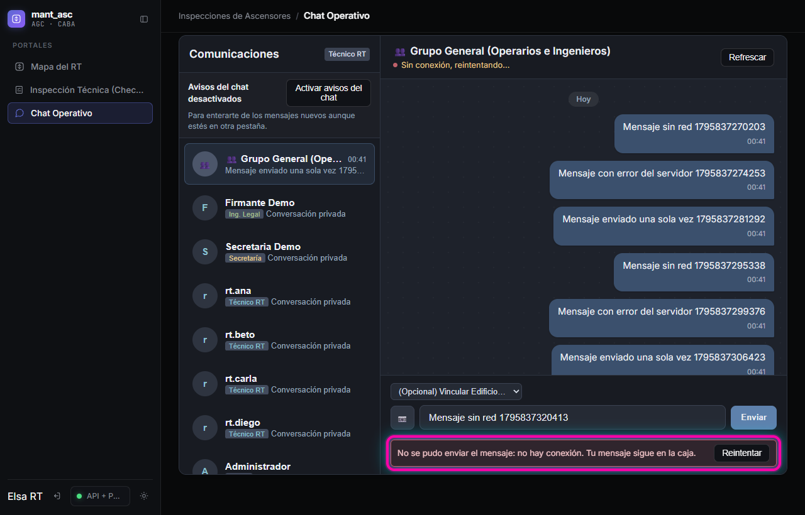
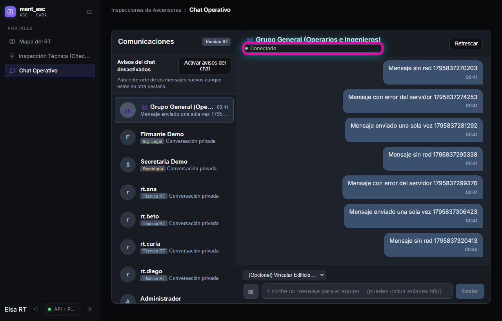
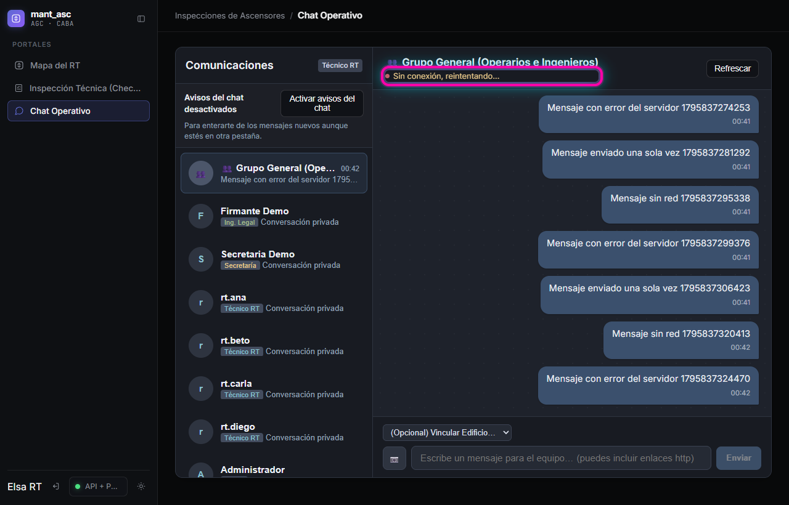
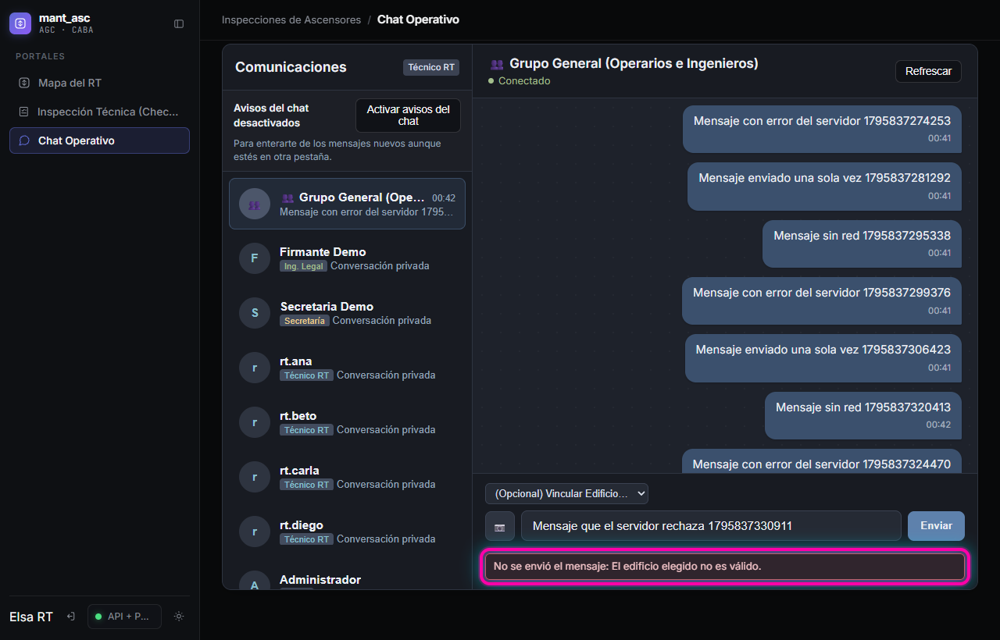
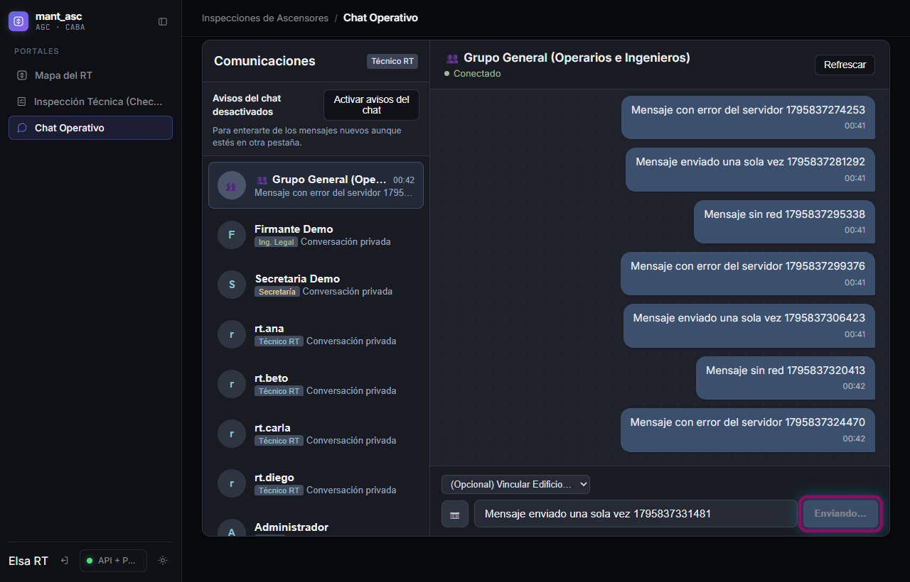

# HU-19 · RF-06 — El chat avisa en pantalla cuando un mensaje no se envió y muestra el estado real de la conexión

**Historia de Usuario:** HU-19: Chat interno entre operarios e ingenieros para consultas y reportes
**Requerimiento:** RF-06 (`REQ-1795778246789`)
**Tipo:** Funcional. No depende de otra Tarea. Es un cambio de la pantalla; la API no cambia.

## El problema

- **Si el envío fallaba, la pantalla no decía nada.** Pasaba sin red, con un error del servidor o con una foto demasiado grande: el texto quedaba en la caja y quien escribía no sabía si el mensaje había salido. Se probó sin red y con un error 500 simulado.
- **La cabecera mentía sobre la conexión.** Decía siempre «Equipo conectado» (en el grupo) o «En línea» (en los privados), aunque no hubiera conexión.

## Qué cambia

| | Antes | Ahora |
|---|---|---|
| Envío sin red o con error del servidor (5xx) | Nada | Debajo de la caja de texto aparece el aviso. Sin red dice «**No se pudo enviar el mensaje: no hay conexión. Tu mensaje sigue en la caja.**»; con un error del servidor, «**…el servidor tuvo un problema…**». El texto y la foto quedan, y el botón **«Reintentar»** lo vuelve a enviar |
| Envío rechazado por el servidor (400) | Nada | «**No se envió el mensaje:** » más el motivo que da la API, por ejemplo «El edificio elegido no es válido.». No ofrece «Reintentar», porque reenviar lo mismo no sirve: hay que corregirlo |
| Cabecera | «Equipo conectado» / «En línea», fijos | **«Conectado»** si la última actualización del hilo salió bien. **«Sin conexión, reintentando…»** si falló, por falta de red o por un error 5xx. Vuelve **sola** a «Conectado» cuando se recupera. Mientras llega la primera respuesta dice «Conectando…» |
| Doble envío | El botón se deshabilitaba, pero dos Enter seguidos podían mandar el mensaje dos veces | Mientras un envío está en curso, el botón dice «Enviando…» y queda deshabilitado, y ningún otro envío sale (ni con clic ni con Enter) |

En el código:

- `chat/envio.ts`: los textos del estado de la conexión y del aviso, y la lectura del motivo que manda la API.
- `chat/ChatOperativoView.tsx`: la cabecera, el aviso con «Reintentar» y la traba del envío en curso.
- Estilos en `chat/chat.css`: punto rojo y texto ámbar sin conexión; aviso con borde rojo.

## Cómo probarlo

```bash
npm run db:up && npm run build
(cd apps/api && npm start)                      # la API en http://127.0.0.1:3050
(cd apps/web && npx vite preview --port 4173)   # la web en https://localhost:4173
bash docs/pruebas/hu-19-hu-19-chat-interno-entre-opera/RF-06-entrega.sh --carga 3
```

Da **6 OK y 0 con error**:

- las pruebas de la web: `envio.test.ts` 20/20, y `src/chat` completo 255/255;
- los controles del código;
- **`RF-06-navegador.cjs` en Chrome, 11 comprobaciones**: corta la red del navegador, simula un error 500 al enviar y un 503 al actualizar, provoca un **rechazo real** de la API (manda un edificio inválido) y demora un envío 2,5 s para probar el doble envío;
- con `--carga 3`, la prueba en el navegador se repite 3 veces completas, sin errores; la más lenta tardó 26 s.

El script crea un RT temporal y lo borra, con sus mensajes, al terminar.

**A mano:**

1. Entrar al **Chat Operativo**. La cabecera dice «Conectado».
2. Cortar la red: en F12 › Red › «Sin conexión», o el modo avión del celular. En unos segundos la cabecera dice «Sin conexión, reintentando…».
3. Escribir un mensaje y tocar **Enviar**: aparece el aviso y el texto sigue en la caja.
4. Volver a conectar: la cabecera vuelve sola a «Conectado». Tocar **Reintentar**: el mensaje aparece en el hilo y el aviso desaparece.

## Capturas (Playwright, Chrome, 1280 × 820)

1. Sin red: la cabecera dice «Sin conexión, reintentando…». Debajo de la caja está el aviso con «Reintentar» y el texto sigue escrito.
   
2. Volvió la red: la cabecera dice «Conectado» y el mensaje reintentado está en el hilo.
   
3. El servidor falla al actualizar (503): «Sin conexión, reintentando…».
   
4. Rechazo real de la API (400): el aviso dice el motivo y no ofrece reintentar.
   
5. Mientras se envía, el botón dice «Enviando…» y está deshabilitado.
   

## Qué quedó afuera o se asumió

- **«Sin conexión» sale de la actualización del hilo**, que se hace cada 3,5 s. Por eso el cambio de estado tarda hasta unos 4 segundos en verse.
  - Un 4xx de la actualización (por ejemplo, una conversación inválida) no cuenta como «sin conexión»: el servidor respondió.
  - Una sesión vencida la resuelve la aplicación como siempre, llevando al ingreso.
- **Un error del servidor al enviar** (500) se trata como «sin conexión» y ofrece «Reintentar». No hay forma de provocar un 500 real del chat sin romper la base, así que en el navegador se simula; el 400, en cambio, es real.
- **«Reintentar» manda lo que está en la caja en ese momento**: si la persona corrigió el texto, sale corregido.
- **No hay cola de mensajes sin conexión.** El mensaje no se guarda para mandarlo solo cuando vuelve la red: queda en la caja y la persona decide cuándo reintentar. Es lo que pide el criterio.
