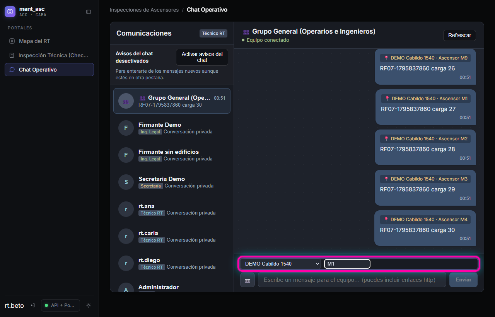
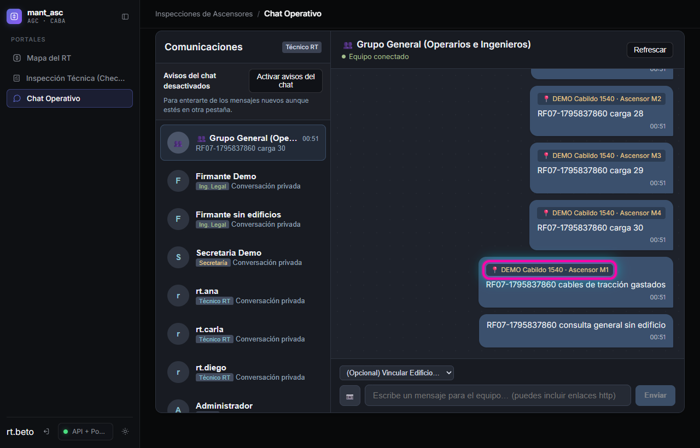
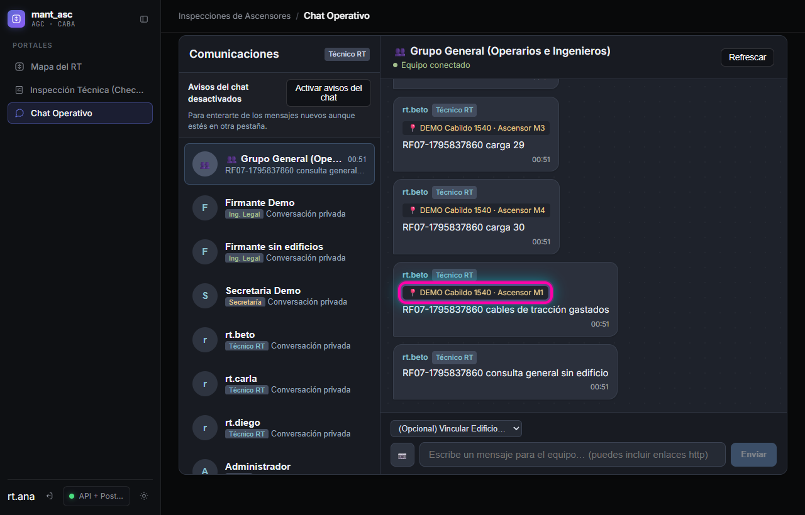
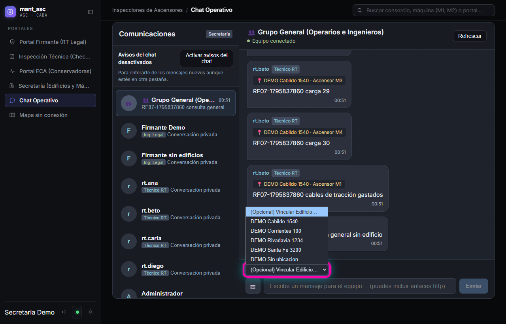

# HU-19 · RF-07 — La etiqueta de edificio del chat se elige para cada mensaje y la ven todos los que lo leen

**Historia de Usuario:** HU-19: Chat interno entre operarios e ingenieros para consultas y reportes
**Requerimiento:** RF-07 (`REQ-1795778246963`)
**Tipo:** Funcional. No depende de otra Tarea. Agrega la migración `040_chat_edificio_nombre`.

## El problema

- **El edificio quedaba elegido después de enviar.** Todos los mensajes siguientes salían etiquetados con ese edificio. Se probó: una foto enviada después del primer mensaje salió con la etiqueta sin que nadie la volviera a elegir.
- **No todos veían la etiqueta.** El nombre del edificio se armaba con una consulta que respeta la seguridad por edificio de quien **lee**. Un Técnico o un Firmante que no está asignado a ese edificio veía el mensaje **sin etiqueta**, aunque quien lo escribió sí la puso.

## Qué cambia

| | Antes | Ahora |
|---|---|---|
| Después de enviar | El edificio y la máquina quedaban elegidos | El selector vuelve a «(Opcional) Vincular Edificio…» y la máquina se vacía. El siguiente mensaje sale sin etiqueta, salvo que se elija un edificio otra vez |
| Quién ve la etiqueta | Solo quien tenía asignado ese edificio (o la Secretaría y el Administrador) | **Todos los que pueden leer el mensaje**: «📍 DEMO Cabildo 1540 · Ascensor M1» |
| Campo de máquina | Aparecía con un edificio, sin límite en la pantalla | Aparece solo con un edificio elegido, admite **hasta 40 caracteres**, se vacía al enviar y al quitar el edificio. La API no guarda una máquina sin edificio |
| Edificios del selector | Los de `/api/consorcios` | Igual, y ahora probado: el Técnico y el Firmante ven sus asignados; la Secretaría y el Administrador, todos |

Cómo funciona:

- **Al enviar,** la API busca el nombre del edificio **como lo ve quien escribe**. Así nadie puede etiquetar un edificio que no ve: si lo intenta, recibe 400.
  - Ese nombre se guarda **con el mensaje**, en la columna nueva `chat_mensajes.edificio_nombre`.
  - El hilo devuelve ese nombre guardado. Para los mensajes viejos, la migración 040 completa el nombre de los que ya tenían edificio.
- **Supuesto de la tarjeta, aplicado:** la etiqueta es parte del mensaje. El nombre lo eligió quien escribe, dentro de su propia lista. Quien lee ve el nombre, pero **no** obtiene acceso a ese edificio: su lista de edificios sigue siendo la suya.
- **Web:**
  - `chat/etiquetaEdificio.ts` arma el texto de la etiqueta y fija el límite de 40 caracteres, el mismo que la API.
  - `chat/ChatOperativoView.tsx` vacía el selector y la máquina después de enviar.

## Cómo probarlo

```bash
npm run db:up && npm run build
(cd apps/api && npm start)                      # la API en http://127.0.0.1:3050 (aplica la migración 040 al arrancar)
(cd apps/web && npx vite preview --port 4173)   # la web en https://localhost:4173
bash docs/pruebas/hu-19-hu-19-chat-interno-entre-opera/RF-07-entrega.sh --carga 30
```

Da **18 OK y 0 con error**. Usa los usuarios de demo y un Firmante temporal sin edificios:

- `rt.beto` tiene DEMO Cabildo 1540 y DEMO Corrientes 100;
- `rt.ana`, solo DEMO Rivadavia 1234;
- `demo.firmante` tiene 3 edificios;
- `demo.secretaria` ve los 5.

Al terminar borra los mensajes que escribió (llevan una marca) y el usuario temporal.

- **Por la API:**
  - qué edificios ve cada uno;
  - que la etiqueta de un mensaje de `rt.beto` la ven igual `rt.ana`, el Firmante sin edificios y la Secretaría;
  - que el mensaje siguiente sale sin etiqueta;
  - las reglas de la máquina.
- **Carga:** 30 mensajes etiquetados de `rt.beto`, leídos por `rt.ana`. Los 30 llegaron con su etiqueta; la vuelta más lenta, de enviar más leer, tardó 332 ms.
- **En Chrome (Playwright, `RF-07-navegador.cjs`, 7 comprobaciones):** el selector de cada uno, el campo de máquina con 45 caracteres tipeados (quedan 40), el selector vacío después de enviar y la etiqueta vista por `rt.ana`.

Las pruebas automáticas:

- API: `chat-etiqueta.e2e-spec.ts` (4) y `chat-etiqueta.int-spec.ts` (8, contra PostgreSQL real con la seguridad por edificio puesta).
- Web: `etiquetaEdificio.test.ts` (8).

**A mano:**

1. Entrar como `rt.beto`, abrir **Chat Operativo**, elegir **DEMO Cabildo 1540** y escribir **M1** en «Máquina».
2. Enviar: el selector vuelve a «(Opcional) Vincular Edificio…». Enviar otro mensaje: sale sin etiqueta.
3. Entrar como `rt.ana` en otra ventana: el primer mensaje muestra «📍 DEMO Cabildo 1540 · Ascensor M1», aunque `rt.ana` no tiene ese edificio. Su selector ofrece solo DEMO Rivadavia 1234.

## Capturas (Playwright, Chrome, 1280 × 820)

1. `rt.beto` eligió DEMO Cabildo 1540 y escribió la máquina. El campo aparece solo con un edificio elegido.
   
2. Después de enviar, el selector volvió a «(Opcional)…». El mensaje siguiente salió sin etiqueta.
   
3. `rt.ana`, sin DEMO Cabildo 1540 asignado, ve la etiqueta del mensaje de `rt.beto`.
   
4. La Secretaría ve los 5 edificios en el selector.
   

## Qué quedó afuera o se asumió

- **El nombre guardado es el del momento del envío.** Si el edificio cambia de nombre, los mensajes viejos conservan el que tenían: es la etiqueta que eligió quien escribió.
- **Si se borra el edificio,** el mensaje conserva su etiqueta; `consorcio_id` queda vacío, como ya pasaba.
- **La migración 040 agrega una columna y completa los mensajes que ya existían.** No cambia permisos.
- **Una máquina sin edificio no se guarda.** La pantalla nunca la manda; un pedido hecho a mano a la API que la traiga sale sin máquina.
