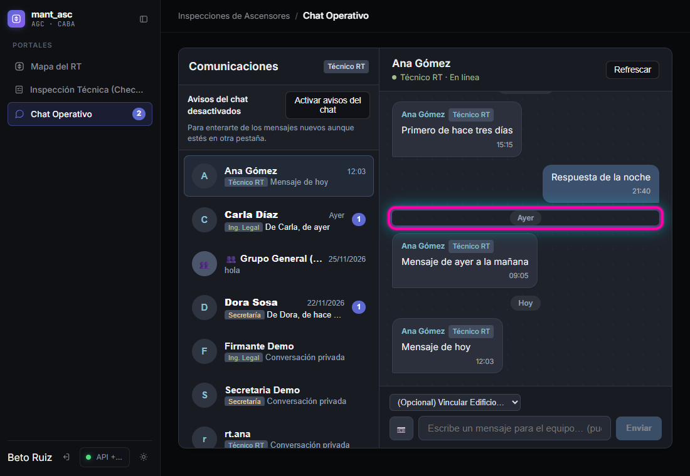
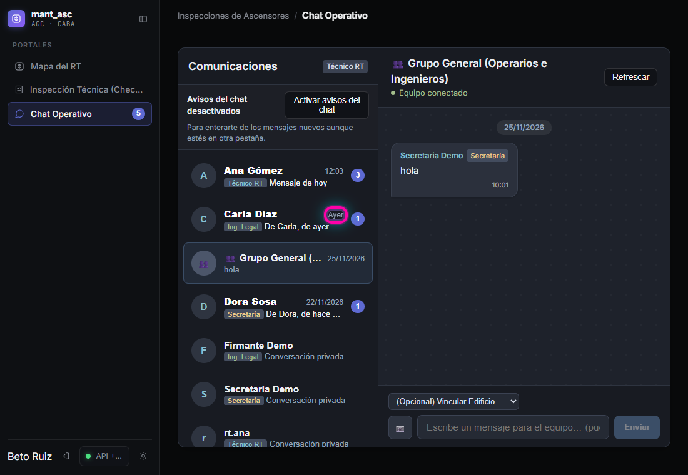
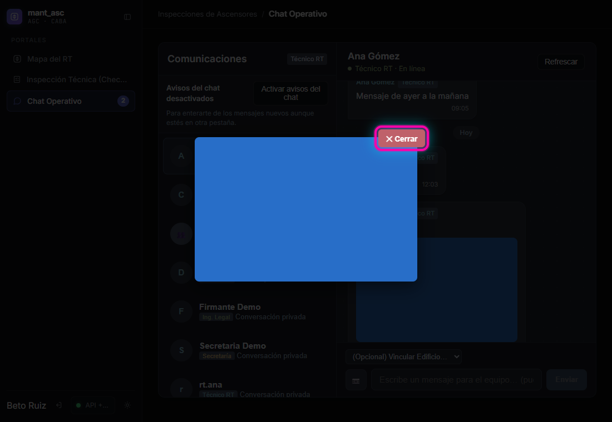

# HU-19 · RF-08 — Detalles del chat: hora en 24 horas con el día, y Escape cierra la foto agrandada

**Historia de Usuario:** HU-19: Chat interno entre operarios e ingenieros para consultas y reportes
**Requerimiento:** RF-08 (`REQ-1795778247124`)
**Tipo:** Funcional. Sale de la revisión del chat del 25/11/2026 (pedido del usuario: «fijate el estado del chat… ¿tiene errores?»).

## El problema

Tres detalles, todos de la pantalla:

1. **La hora usaba el formato del dispositivo** (`toLocaleTimeString`): en un celular o una computadora con el reloj de 12 horas se veía «3:15 PM», y con otra zona horaria, la hora de otro lugar. Era además **la única prueba que fallaba en `dev`**: la guardiana de HU-12 RF-03 («ninguna fecha con hora se formatea con `toLocaleString` o `toLocaleTimeString`»).
2. **El mensaje mostraba solo la hora, sin el día**: uno de ayer se veía igual que uno de hoy.
3. **La foto agrandada solo se cerraba tocando el fondo**: Escape no la cerraba, la «✕» no decía qué era y, al cerrarla, el foco (para quien usa el teclado) se perdía.

## Qué cambia

| | Antes | Ahora |
|---|---|---|
| Hora de cada mensaje y de la lista de chats | La del dispositivo (a veces con AM/PM) | **24 horas (HH:MM) en la hora de Buenos Aires**, con el mismo formato que el resto de la aplicación (`fechas/formato`): 15:15 y nunca 03:15, 00:05 y nunca 24:05 |
| El día de los mensajes | No se veía | Un **separador** delante del primer mensaje de cada día: **«Hoy»**, **«Ayer»** o la **fecha** (21/11/2026) |
| La lista de chats | Solo la hora | Hoy, la **hora**; de ayer, **«Ayer»**; de antes, la **fecha** |
| La foto agrandada | Se cerraba tocando el fondo | Se cierra con **Escape**, con el botón **«✕ Cerrar»** (visible, con texto) y tocando el fondo; **el foco vuelve a la miniatura** desde la que se abrió. Es un diálogo (`role="dialog"`), al abrirse el foco entra en «Cerrar» y Tab no se escapa de la ventana |
| La miniatura de la foto | Solo con el mouse | Se enfoca con el teclado y se abre con **Enter o espacio** |
| La prueba guardiana de HU-12 RF-03 | **Fallaba** | **Pasa**: ninguna parte del chat usa el formato de hora del dispositivo |

Detalles del código:

- **`fechas/formato.ts`** (el módulo común de fechas): se suman `fecha()` («21/11/2026») y `claveDeDia()` («2026-11-21»), siempre en la hora de Buenos Aires, esté donde esté el navegador.
- **`chat/dias.ts`:** `etiquetaDeDia` («Hoy», «Ayer» o la fecha), `horaOFecha` (lo que dice la lista de chats), `conSeparadores` (pone el separador delante del primer mensaje de cada día; un mensaje sin fecha válida no cambia de día) y `diaAnterior` (aritmética de calendario: cruza fin de mes, de año y años bisiestos). El día cambia a la **medianoche de Buenos Aires** (03:00 UTC), no a la de UTC.
- **`chat/foto.ts`:** qué teclas cierran la foto (Escape, o «Esc» en navegadores viejos) y cuáles abren una miniatura enfocada.
- **`ChatOperativoView.tsx`:** usa todo lo anterior y maneja el foco de la foto agrandada.

## Cómo probarlo

```bash
bash docs/pruebas/hu-19-hu-19-chat-interno-entre-opera/RF-08-entrega.sh
```

Da **9 verificaciones OK**; contra el estado anterior, 2 OK y 7 errores. No necesita la API ni la base: es todo de la pantalla. Corre la prueba guardiana de HU-12 RF-03 y las pruebas nuevas, y comprueba en el código que el chat ya no usa la hora del dispositivo, que la hora sale de `hora()` y `horaOFecha()`, que el hilo usa los separadores y que la foto agrandada tiene su cierre.

**La pantalla, a mano** (con la web levantada; para ver la diferencia conviene un navegador en inglés o en otra zona horaria):

1. Ingresar con alguien que tenga conversaciones de varios días → **Chat Operativo** → una conversación: delante de los mensajes de cada día hay un separador **«Hoy»**, **«Ayer»** o la **fecha**, y cada mensaje muestra su hora en 24 horas.

   

2. En la lista de conversaciones, el último mensaje dice la **hora** si es de hoy, **«Ayer»** o la **fecha**.

   

3. Tocar una foto (o enfocarla con Tab y apretar Enter): se agranda con el botón **«✕ Cerrar»**. **Escape**, «Cerrar» o tocar el fondo la cierran y **el foco vuelve a la miniatura**.

   

## Pruebas automáticas

| Archivo | Qué prueba |
|---|---|
| `web/src/chat/dias.test.ts` (31) | `diaAnterior` (fin de mes y de año, bisiesto, días de un dígito); «Hoy», «Ayer» y la fecha; **la medianoche de Buenos Aires** (no la de UTC); un mensaje del futuro; vacío e inválido; la hora de la lista; los separadores (un solo día, varios, cruzando la medianoche, un mensaje sin fecha, sin modificar lo que recibe); y **desde un navegador de Tokio** |
| `web/src/fechas/formato-dia.test.ts` (6) | `fecha` y `claveDeDia` en la hora de Buenos Aires, el cambio de día y de año, y desde un navegador de otra zona |
| `web/src/chat/foto.test.ts` (29) | Las teclas que cierran y abren; que el chat **no use** `toLocaleTimeString`, `toLocaleString` ni `toLocaleDateString`; la hora, la lista y los separadores en la pantalla; y la foto agrandada: diálogo, botón «Cerrar» con texto, Escape solo mientras está abierta, el foco entra en «Cerrar», Tab no se escapa, el foco vuelve a la miniatura (si sigue en pantalla), la miniatura se enfoca y se abre con el teclado |
| `web/src/fechas/formato.test.ts` (existente, de HU-12 RF-03) | **Pasa**: ya no falla por el chat |

**En un navegador real, configurado como un dispositivo de Tokio y en inglés de Estados Unidos** (cuyo reloj diría «03:15 AM» para las 15:15 de Buenos Aires), **22 de 22**: la lista muestra la hora de hoy en 24 horas, «Ayer» y la fecha; el hilo trae los separadores «fecha», «Ayer» y «Hoy» en ese orden y entre los mensajes de días distintos (4 mensajes, los separadores no cuentan); las horas son 15:15, 21:40, 09:05 y la de hoy, **ninguna con AM/PM**; con el teclado, Enter abre la foto, el foco entra en «Cerrar», Tab no se escapa, Escape la cierra y el foco vuelve a la miniatura; con el mouse, la miniatura la abre, «Cerrar» la cierra y el foco vuelve; tocar la foto no la cierra; tocar el fondo sí; y sin errores de página.

**Pruebas de mutación:** se rompió a propósito el código en 72 puntos (los formatos de fecha y clave de día, el cálculo del día anterior, «Hoy» y «Ayer», la hora de la lista, los separadores, las teclas, la hora de la pantalla, el diálogo, el botón «Cerrar», Escape, el foco, la miniatura y los estilos) y **71 fueron detectadas**; la restante es equivalente (sacar una comprobación que ya hace la función que sigue). En la primera pasada sobrevivió una por faltar un caso de prueba (el día anterior de un solo dígito) y de otra el texto no estaba bien escrito: se reforzó y se corrigió.

**Suite completa de la web:** 974 en verde, **sin ningún fallo** (antes quedaba el de la prueba guardiana). API e integración no se tocaron: 1642 y 254 en verde con los mismos 1 y 36 fallos de antes que no son de esta tarjeta.

## Limitaciones

- «Hoy» y «Ayer» se calculan con el reloj del dispositivo y la hora de Buenos Aires: si el reloj del dispositivo está mal, el día se ve mal. Los separadores se actualizan con la actualización automática del hilo (cada 3,5 segundos), no a la medianoche exacta.
- La fecha de los separadores y de la lista es numérica (21/11/2026): no lleva el día de la semana.
- La hora del aviso del navegador (RF-10) no la muestra el aviso, así que no cambia.
