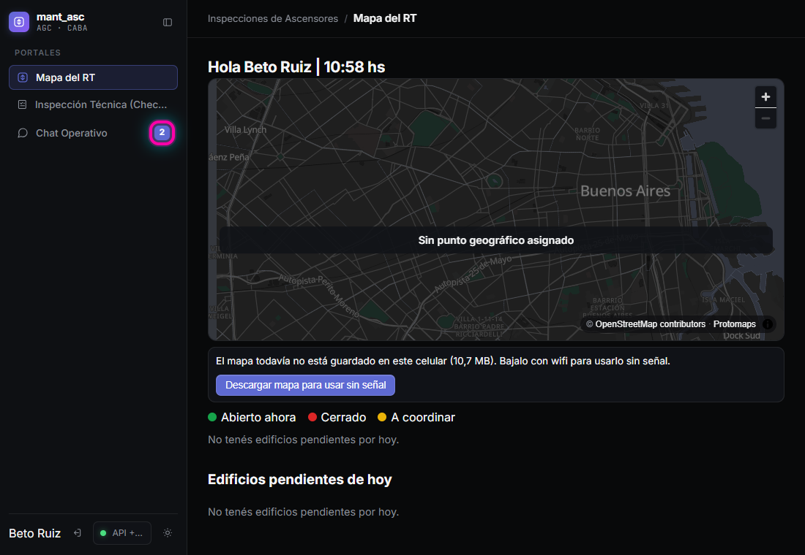
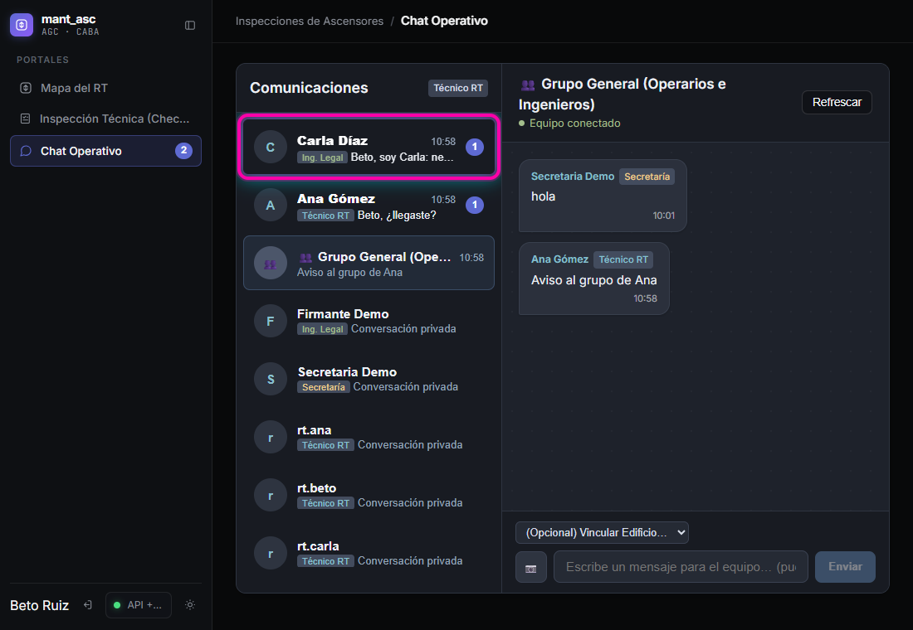
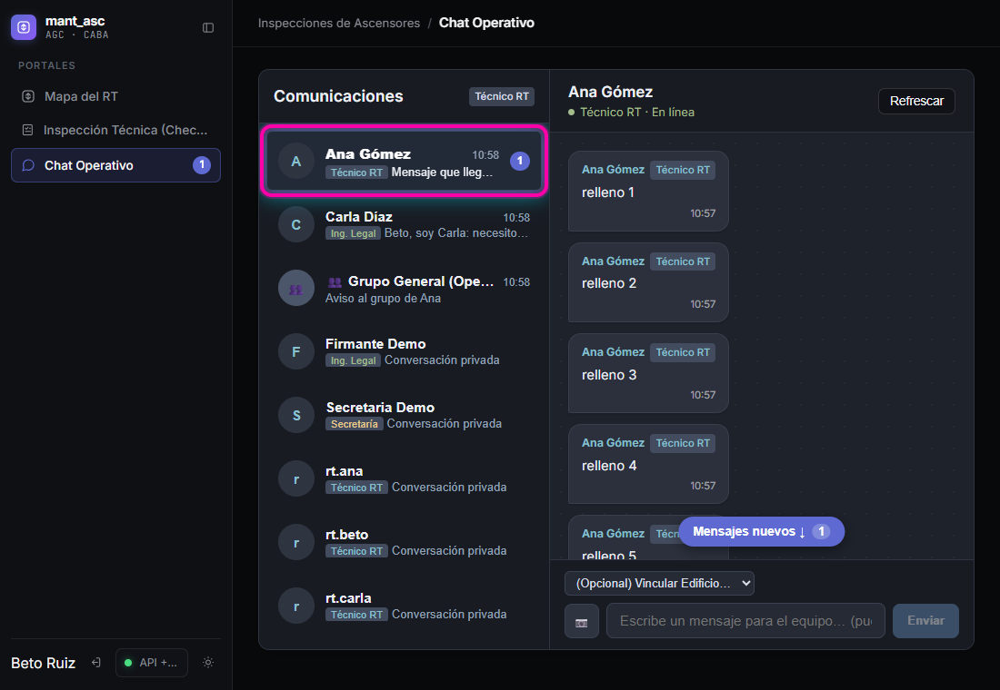
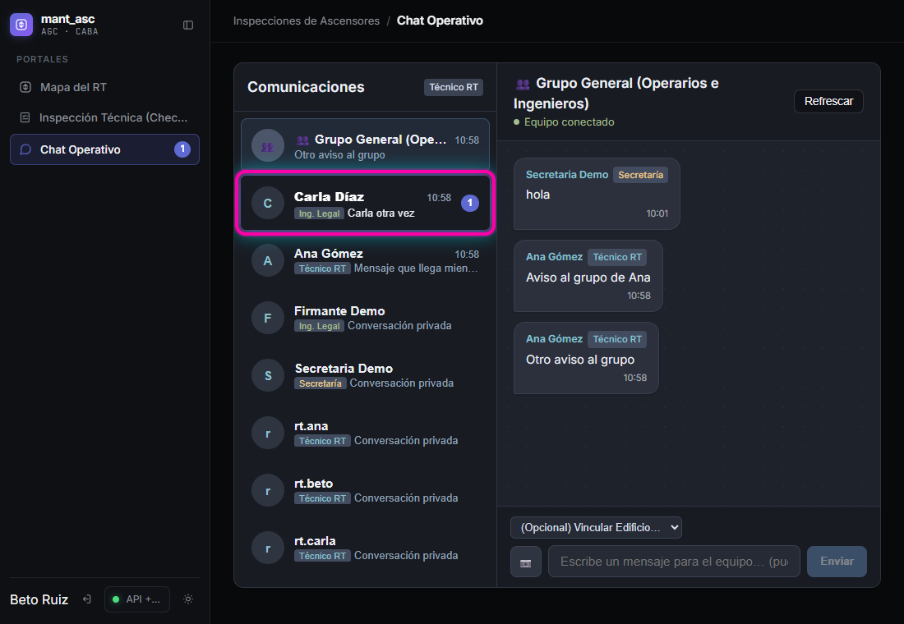

# HU-19 · RF-09 — El chat marca lo que no leíste: contador por conversación, en el menú y en el título de la pestaña

**Historia de Usuario:** HU-19: Chat interno entre operarios e ingenieros para consultas y reportes
**Requerimiento:** RF-09 (`REQ-1795778247270`)
**Tipo:** Funcional. Sale de la revisión del chat del 25/11/2026 (pedido del usuario: «que lleguen/aparezcan/manden notificaciones también»). Depende de RF-02 (el hilo muestra los mensajes más nuevos) y RF-03 (la Secretaría como contacto). Es la base de los avisos del navegador (RF-10).

## El problema

El chat no tenía ninguna noción de «no leído»: la lista de conversaciones se cargaba **una sola vez** al abrir la pantalla y solo se consultaba la conversación abierta, así que quien estaba en otra conversación o en otra pestaña de la aplicación (Mapa del RT, Inspección…) **no se enteraba** de que le habían escrito. Probado con dos usuarios a la vez.

## Qué cambia

| | Antes | Ahora |
|---|---|---|
| Lista de conversaciones | Se cargaba una vez | **Se actualiza sola cada 5 s**, con un **contador** de mensajes sin leer en cada conversación, su nombre en **negrita** y la conversación con el mensaje más reciente **primero** |
| Menú lateral y barra del celular | Nada | La pestaña **«Chat Operativo»** muestra el **total** sin leer (hasta «99+»), esté la persona en la pantalla que esté (se pregunta cada 8 s) |
| Título de la pestaña del navegador | Siempre el mismo | Lleva el total por delante: **«(3) mant_asc · Inspecciones de Ascensores»** |
| Lo leído | No existía | Se guarda **en el servidor, por usuario y conversación** (`chat_lecturas`): desde otro dispositivo los contadores son los mismos |
| Lo propio | — | Lo que uno escribe **nunca** cuenta como sin leer |
| Lo ajeno | — | Cada uno cuenta **solo** el grupo general y los privados que le escribieron a él |

Cómo funciona:

- **Qué cuenta como «sin leer»:** los mensajes **de otros** posteriores al último que la persona vio en esa conversación. Para el grupo, si nunca lo abrió, cuentan los posteriores a la fecha en que se creó su usuario (no se le acumula lo anterior a que existiera). Los mensajes que ya estaban escritos cuando se instaló esta tarjeta se dan por leídos (la migración `039_chat_lecturas` lo hace), así que los contadores empiezan en cero.
- **Cuándo se marca leído:** apenas la persona **ve** la conversación abierta: con la pestaña a la vista y **mirando el final del hilo**. Si está leyendo mensajes anteriores más arriba, lo que llega **queda sin leer** (y aparece el aviso «Mensajes nuevos ↓» de RF-02) hasta que vuelve al final, a mano o tocando el aviso. Al volver a mirar la pestaña o enfocar la ventana también se marca. El grupo general se abre por defecto, así que queda leído al abrir el chat.
- **La conversación que se está mirando no muestra contador** mientras se esté al final del hilo: lo que se ve ya está leído.
- **API:** `GET /api/chat/canales` suma `noLeidos` a cada conversación (la lista sigue empezando por el grupo); `GET /api/chat/no-leidos` devuelve `{ total }`; `POST /api/chat/lecturas` con `{ sala, hasta }` marca leído hasta ese mensaje (la lectura **solo avanza**, nunca retrocede) y devuelve `{ sala, noLeidos, total }`. El total solo suma las conversaciones que figuran en la lista de la persona (global y sus contactos): lo de alguien dado de baja no se podría abrir para leerlo. Un mensaje que no es de esa conversación, un identificador inválido o una conversación con uno mismo responden **400**; la ECA, **403**.
- **Web:** `chat/noLeidos.ts` (contador «99+», título, orden de la lista), `chat/useNoLeidosChat.ts` (pregunta el total cada 8 s, lo actualiza al instante cuando la pantalla del chat marca algo, y no hace ningún pedido si el usuario no tiene chat), el menú de `App.tsx` y la pantalla del chat.

## Cómo probarlo

```bash
npm run db:up                                   # la base
npm run dev                                     # la API y la web
bash docs/pruebas/hu-19-hu-19-chat-interno-entre-opera/RF-09-entrega.sh
```

Da **24 verificaciones OK**; contra el estado anterior, 1 OK y 23 errores. Crea cinco usuarios temporales (dos RT, un Firmante, una Secretaría y una ECA) y los borra, con sus mensajes y lecturas, al terminar. Comprueba por la API real: un usuario nuevo no acumula lo anterior del grupo, el contador de cada conversación, el total, que lo propio no cuente, marcar leído (hasta el último, hasta uno intermedio, que no retroceda y que no toque otras conversaciones), que al ingresar de nuevo los contadores sean los mismos, que cada usuario tenga su propio punto de lectura, la privacidad (Carla no cuenta lo de Ana con Beto ni con Dora y no puede marcarlo), la ECA con 403 y los pedidos inválidos con 400.

**La pantalla, a mano** — con la web levantada y dos usuarios (por ejemplo dos RT; el segundo escribe desde otra ventana):

1. Ingresar con el primero y quedarse en **«Mapa del RT»**. Que el segundo le escriba por el grupo y por privado: en unos segundos, **la pestaña «Chat Operativo» del menú muestra el total (2)** y **el título de la pestaña del navegador empieza con «(2)»**.

   

2. Abrir **Chat Operativo**: cada conversación con mensajes sin leer muestra su **contador** y su nombre en **negrita**, y la que tiene el mensaje más reciente va **primero**. El grupo general, que se abre por defecto, queda leído al entrar.

   

3. Abrir una conversación: **su contador desaparece** y el total del menú (y el título) bajan. Si se está leyendo más arriba y llega un mensaje, la conversación **mantiene su contador** y aparece «Mensajes nuevos ↓»; al volver al final queda leída.

   

4. Ingresar con el mismo usuario desde **otra ventana** (otro dispositivo): el menú y la lista muestran **los mismos números**; lo que se leyó en la primera sigue leído.

   

## Pruebas automáticas

| Archivo | Qué prueba |
|---|---|
| `api/test/chat-no-leidos.int-spec.ts` (29) | **Contra PostgreSQL de verdad**: contador por conversación, total (también con un usuario dado de baja), lo propio, marcar leído (último, intermedio, solo avanza, **misma fecha**, mayúsculas), otro dispositivo, usuario nuevo sin lo anterior, privacidad, pedidos inválidos y el repositorio directo con su seguridad |
| `api/test/chat-no-leidos.e2e-spec.ts` (12) | Por la API con sesiones: la lista con `noLeidos` (el grupo sigue primero), `no-leidos`, `lecturas`, la privacidad, 6 pedidos inválidos, la ECA con 403 y sin sesión 401 |
| `api/test/chat-no-leidos.spec.ts` (42) | El servicio y la puerta: cada regla de lo no leído y de marcar leído |
| `web/src/chat/noLeidos.test.ts` (46) | El contador «99+», el título (poner y sacar el contador sin acumular), el orden de la lista, los intervalos, y las reglas del hook, del menú y de la pantalla |

**En un navegador real** (tres usuarios a la vez, uno escribiendo por la API, más una ECA), **26 de 26**: estando en «Mapa del RT» el menú dice 2 y el título «(2) …» (en unos 7 s); la lista muestra los contadores de Ana y de Carla, en negrita y con Carla (la más reciente) primero; al abrir una conversación su contador desaparece y el total y el título bajan; un mensaje nuevo en la conversación que se mira no deja contador; lo que el usuario escribe no cuenta; al abrir todo, el menú queda sin número y el título vuelve al de siempre; leyendo más arriba lo que llega cuenta en la conversación y en el menú, y al volver al final se lee; otro dispositivo muestra el mismo total y los mismos contadores; Carla no tiene contadores por los privados ajenos; con más de 99 sin leer el menú dice «99+»; y la ECA no ve pestaña ni números, no cambia el título y **no hace ningún pedido** al chat.

**Pruebas de mutación:** se rompió a propósito el código en 98 puntos (el SQL de lo no leído y de marcar leído, el servicio, el controlador, la puerta, el contador, el título, el orden, el hook, el menú y la pantalla) y **95 fueron detectadas**; las otras 3 son mutaciones equivalentes (no cambian el comportamiento: renombrar una constante que usan los dos lados, copiar un arreglo que ya era nuevo, contar mensajes ajenos que el filtro posterior descarta). Ocho sobrevivieron en la primera pasada: cuatro se detectaron al reforzar las pruebas (entre ellas, una que llama al repositorio con su contexto de seguridad), uno no cambiaba nada y se rehízo (y se detectó), y tres se juzgaron equivalentes.

**Suites completas:** API 1622 en verde y 1 fallo que no es de esta tarjeta (`paradas.spec.ts`, de la HU-10 RF-08 de otro desarrollador); web 810 en verde y 1 fallo previo (`fechas/formato.test.ts`, lo arregla HU-19 RF-08); integración 244 pasan y 36 fallan, las mismas de antes.

## Limitaciones

- **Solo con la aplicación abierta:** el total del menú y el título se actualizan cada 8 s mientras la aplicación esté abierta en el navegador (incluso con la pestaña en segundo plano, aunque el navegador puede espaciar los pedidos); con la aplicación cerrada no hay nada. Los **avisos del navegador** son de RF-10.
- **El contador de la conversación abierta** se apaga mientras se está al final del hilo: si el servidor falla al guardar «leído», el contador aparece en cuanto se deja de mirar esa conversación (el pedido se reintenta con la próxima actualización).
- **Un usuario nuevo** no acumula lo escrito en el grupo antes de que existiera; para los privados no hace falta (no puede haber mensajes anteriores a su usuario).
- La hora de cada mensaje y de la lista sigue usando el formato del dispositivo (HU-19 RF-08).
