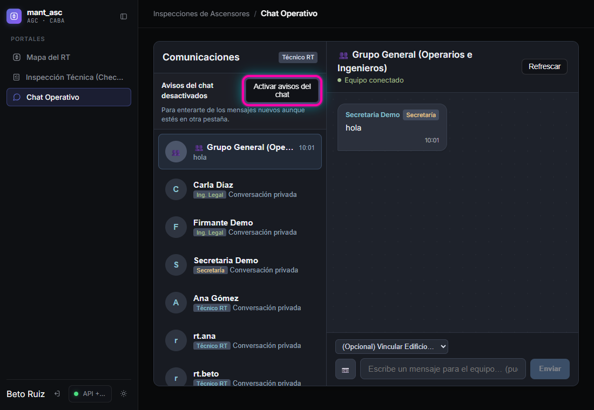
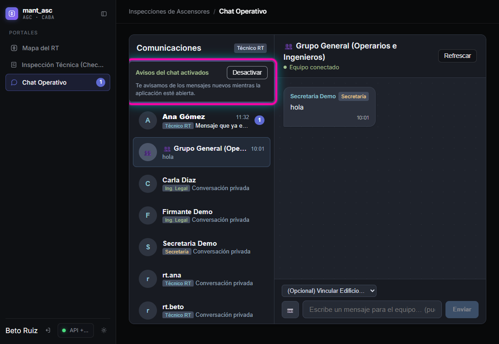
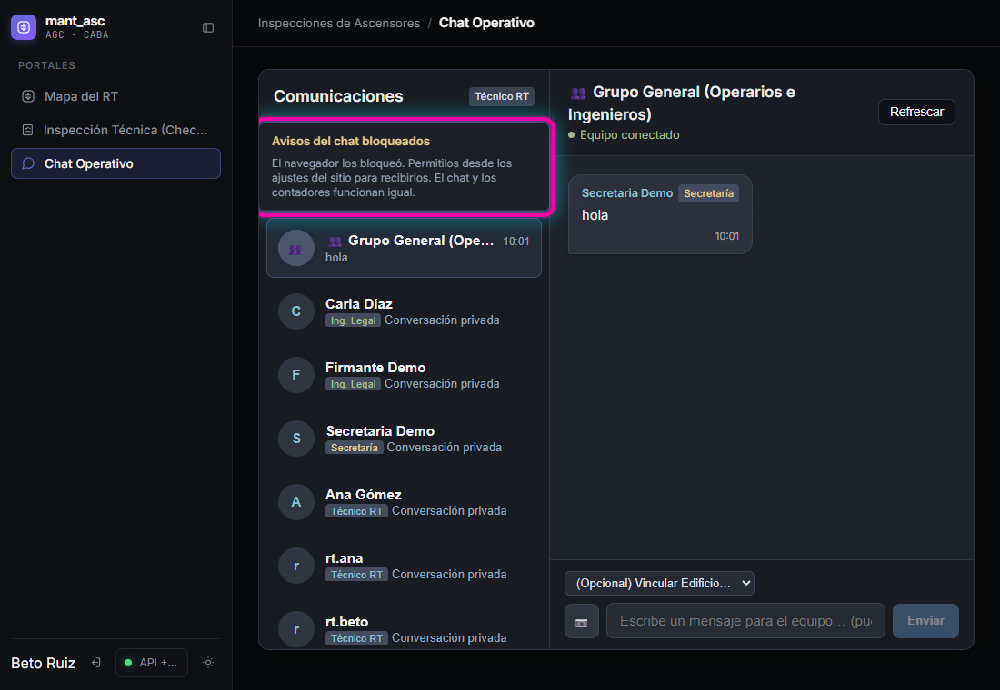
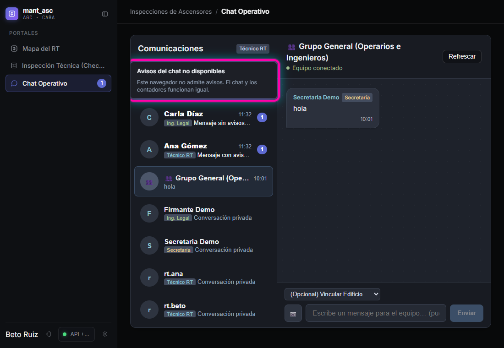

# HU-19 · RF-10 — Avisos del navegador cuando llega un mensaje nuevo del chat

**Historia de Usuario:** HU-19: Chat interno entre operarios e ingenieros para consultas y reportes
**Requerimiento:** RF-10 (`REQ-1795778247416`)
**Tipo:** Funcional. Es la prueba de notificaciones que pediste el 25/11/2026 («podríamos probar con las notis del navegador por si acaso»). Depende de RF-09 (lo no leído), que es lo que sabe qué mensajes son nuevos.

## Qué hace

Cuando llega un mensaje nuevo de otra persona, el navegador muestra un **aviso** con el **nombre de quien escribió** y el **comienzo del mensaje** (hasta 100 caracteres, sin la foto). Tocar el aviso lleva a la aplicación y **abre esa conversación**.

**Alcance, para que no haya sorpresas:** funciona **mientras la aplicación esté abierta en el navegador** (también con la pestaña en segundo plano o estando en otra pestaña de la aplicación). Con la aplicación cerrada o el celular bloqueado **no llega nada**: eso necesitaría notificaciones push con un servidor de claves y sería otra tarjeta. El aviso puede tardar hasta unos 8 segundos (se pregunta cada 8 s por lo nuevo).

| | Cómo es |
|---|---|
| **Activarlos** | En «Chat Operativo», arriba de la lista de conversaciones: **«Avisos del chat desactivados»** con el botón **«Activar avisos del chat»**. Recién al tocarlo el navegador pregunta si se permite; **nunca se pregunta al cargar la página ni al abrir el chat** |
| **Estados** | **Activados** (con «Desactivar»), **desactivados** (con «Activar avisos del chat»), **bloqueados** (el navegador los bloqueó: se explica cómo permitirlos) y **no disponibles** (el navegador no admite avisos). Los dos últimos dicen que **el chat y los contadores funcionan igual** |
| **Qué dice el aviso** | Título: el nombre de quien escribió (en el grupo, «Carla Díaz · Grupo General»). Texto: el comienzo del mensaje, en una línea y de hasta 100 caracteres (con «…» si se cortó). Un mensaje con foto avisa con su texto («📷 Foto adjunta»), **nunca con la imagen** |
| **Cuándo avisa** | Por cada mensaje nuevo de otra persona **salvo** que estés mirando esa conversación con la pestaña a la vista. Si la pestaña está en segundo plano, o estás en otra conversación o en otra pestaña de la aplicación, avisa |
| **Cuándo NO avisa** | Por lo que **vos escribís**; por la conversación que **ya estás viendo** con la pestaña a la vista; ni por lo que **ya estaba sin leer al abrir la aplicación** (solo por lo que llega después); ni con los avisos desactivados |
| **Varios mensajes seguidos** | Una conversación tiene **un solo aviso**: el siguiente lo **reemplaza** (misma marca, `tag`) en vez de apilarse; tres mensajes que llegan juntos dan un aviso con el último |
| **Tocar el aviso** | Con la aplicación abierta: se trae al frente, pasa a «Chat Operativo» y abre esa conversación. Con la aplicación cerrada: se abre en `/?chat=<conversación>` y entra directo a ella |
| **Se recuerda** | La preferencia queda en **este dispositivo**, por usuario: al recargar o volver a entrar sigue activada, sin volver a preguntar. «Desactivar» detiene los avisos |

Cómo está hecho:

- **API:** `GET /api/chat/no-leidos` sigue devolviendo `total` y suma `conversaciones`: de cada conversación con algo sin leer, el **último mensaje que le escribió otra persona** (`id`, quién, hasta 200 caracteres del texto, si tiene foto y cuándo; **nunca la foto**). Lo propio no aparece y cada usuario solo recibe lo suyo (el grupo y los privados dirigidos a él).
- **Web:** `chat/avisos.ts` (cuándo avisar, cómo se arma el aviso, el permiso y la preferencia), `useAvisosDelChat.ts` (el hook), `visto.ts` (qué conversación se está mirando), y el botón en la pantalla del chat. Cada respuesta de «sin leer» (RF-09) pasa por los avisos: la primera vez se toma como base y solo se avisa de lo que llega después.
- **Service worker** (`public/sw-chat.js`, cargado por el service worker de la aplicación): el aviso se muestra con `registration.showNotification` (en **Chrome de Android** es la única forma: `new Notification()` no funciona) y, al tocarlo, trae la aplicación al frente y le pide abrir la conversación, o abre `/?chat=…`. Sin service worker se usa el aviso de la página.

## Cómo probarlo

```bash
npm run db:up                                   # la base
npm run dev                                     # la API y la web
bash docs/pruebas/hu-19-hu-19-chat-interno-entre-opera/RF-10-entrega.sh
```

Da **16 verificaciones OK**; contra el estado anterior, 5 OK y 11 errores. Comprueba lo que el servidor le da a la pantalla para avisar: de cada conversación con algo sin leer, el último mensaje de otra persona con el nombre de quien escribió y su texto; una foto como «conFoto» y **sin la imagen** (la respuesta pesa ~700 bytes); el texto recortado a 200; que lo propio no aparezca; que lo leído desaparezca y un mensaje nuevo vuelva a aparecer con su propio id; la privacidad; la ECA con 403; y que la web sirva `sw-chat.js`. Los avisos del navegador en sí no se pueden ver desde un script: están verificados en un navegador real (abajo).

**La pantalla, a mano** — con la web levantada y dos usuarios (uno escribe desde otra ventana):

1. Ingresar con el primero → **Chat Operativo**. Arriba de la lista dice **«Avisos del chat desactivados»** con el botón **«Activar avisos del chat»**. Hasta tocarlo, el navegador no pregunta nada.

   

2. Tocar el botón y **permitir** en la pregunta del navegador: queda **«Avisos del chat activados»** con el botón **«Desactivar»**. Irse a otra pestaña de la aplicación (por ejemplo «Mapa del RT») y que el segundo usuario escriba: aparece el aviso del navegador con su nombre y el comienzo del mensaje. Tocarlo abre esa conversación.

   

3. Si en la pregunta se elige **bloquear** (o se bloquearon antes los avisos del sitio): dice **«Avisos del chat bloqueados»**, explica cómo permitirlos y **no ofrece el botón**. Los contadores de lo no leído y el chat funcionan igual.

   

4. En un navegador que no admite avisos dice **«no disponibles»** y explica que el chat y los contadores funcionan igual.

   

## Pruebas automáticas

| Archivo | Qué prueba |
|---|---|
| `web/src/chat/avisos.test.ts` (97) | Los textos de cada estado; el recorte a 100; el aviso que se arma (título, cuerpo, foto); **la decisión de avisar** (la primera vez es base, un id nuevo avisa, el mismo no, la conversación que se mira no, con la pestaña escondida sí, una conversación leída sale de la base); la preferencia por usuario (también con el almacenamiento bloqueado); el estado y la activación contra una API de avisos simulada (**el permiso se pide solo en `activarAvisos`**, una vez, y no si ya está dado o denegado); mostrar el aviso por el service worker o por la página (marca, `renotify`, sin imagen, qué pasa si algo falla); `/?chat=`; **el manejador del service worker** (`sw-chat.js` cargado en un contexto simulado: abre, trae al frente, elige la ventana a la vista, abre `/?chat=…` si estaba cerrada, ignora lo que no es del chat); y cómo lo usa la aplicación (**`requestPermission` aparece una sola vez en todo el código**) |
| `api/test/chat-avisos.int-spec.ts` (10) | **Contra PostgreSQL de verdad**: el último de otro con el nombre real, la foto sin imagen, el texto recortado, lo propio, la **misma fecha** (desempate por id), leído y de nuevo, privacidad, un usuario dado de baja, la ECA, y el repositorio directo |
| `api/test/chat-avisos.e2e-spec.ts` (7) | Por la API con sesiones: la forma de la respuesta (el `total` de siempre y `conversaciones`), la foto, lo propio, la privacidad, lo leído, la ECA con 403 y sin sesión 401 |
| `api/test/chat-avisos.spec.ts` (13) | El servicio: qué conversaciones incluye, el último de otro, el recorte, la foto, quien ya no es contacto y un repositorio que no encuentra el mensaje |

**En un navegador real** (tres usuarios, uno escribiendo por la API, una ECA, y una corrida con service worker), **40 de 40**: al cargar la página y al abrir el chat no se pidió permiso; el botón pidió permiso una vez; con «bloquear» dice «bloqueados», lo explica y el contador del chat igual aparece; sin API de avisos dice «no disponibles» y todo anda; con el permiso dado queda «activados»; **lo que ya estaba sin leer al abrir no avisó**; estando en «Mapa del RT» llegó el aviso en ~2 s con el título «Ana Gómez» y el comienzo del mensaje, **99 caracteres con «…»** (un texto de más de 100), sin imagen ni ícono, con una marca por conversación y `renotify`; un mensaje del grupo avisó «Carla Díaz · Grupo General»; uno con foto avisó «📷 Foto adjunta» sin la imagen; **tres mensajes seguidos dieron un solo aviso**, con el último, y el siguiente usó la misma marca (el navegador lo reemplaza); **lo que escribe Beto no avisó**; tocar el aviso llevó al chat y abrió la conversación con Carla y cerró el aviso; **un mensaje de la conversación que se estaba viendo no avisó**, pero con la pestaña en segundo plano sí y estando en otra conversación del chat también; «Desactivar» detuvo los avisos y recargar la página los dejó activados **sin volver a preguntar**; `/?chat=<Ana>` abrió el chat en esa conversación y limpió la dirección; un mensaje `abrir-chat` del service worker abrió el grupo; la ECA no tiene pestaña ni hizo ningún pedido al chat; y con service worker (como en el celular) `registration.getNotifications()` trajo el aviso con título, texto, marca y la conversación.

**Pruebas de mutación:** se rompió a propósito el código en 109 puntos (el SQL del resumen, el servicio, el recorte, el armado del aviso, la decisión de avisar, el permiso y la preferencia, cómo se muestra, el hook, la pantalla, la aplicación, el service worker y su carga) y **108 fueron detectadas**; la restante es equivalente (llamar dos veces seguidas con la misma respuesta no cambia lo que se avisa). Siete sobrevivieron en la primera pasada: se reforzaron las pruebas (la del repositorio sin mensajes de otros y las afirmaciones sobre el service worker, la dirección y el botón «Desactivar») y uno que no compilaba se rehízo.

**Suites completas:** API 1642 en verde y 1 fallo que no es de esta tarjeta (`paradas.spec.ts`, de la HU-10 RF-08 de otro desarrollador); web 907 en verde y 1 fallo previo (`fechas/formato.test.ts`, lo arregla HU-19 RF-08); integración 254 pasan y 36 fallan, las mismas de antes.

## Limitaciones

- **Solo con la aplicación abierta** (ver arriba); y hasta unos 8 segundos de demora.
- **No pude ejercitar el toque del aviso del sistema operativo** con un navegador automatizado. Lo verificado es: el manejador del service worker (en un contexto simulado), el aviso con su `data` por `registration.getNotifications()`, y que la aplicación abra la conversación al recibir el mensaje `abrir-chat` y al entrar por `/?chat=`; tocar el aviso de la página sí se probó. Conviene probarlo una vez a mano en el celular.
- **El service worker de producción no se armó localmente** (el comando de armado no se corrió): `public/sw-chat.js` se carga con `importScripts` en el service worker de la aplicación y se verificó en el de desarrollo. Se confirma con el próximo armado del sitio.
- En **iPhone/iPad** el navegador solo admite avisos si la aplicación se instaló en la pantalla de inicio (iOS 16.4 o superior).
- Si hay **dos pestañas** de la aplicación abiertas, cada una avisa (con la misma marca, así que se reemplazan).
- El aviso muestra el **comienzo** del último mensaje; si llegan varios juntos, solo el último.
