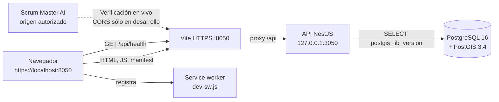
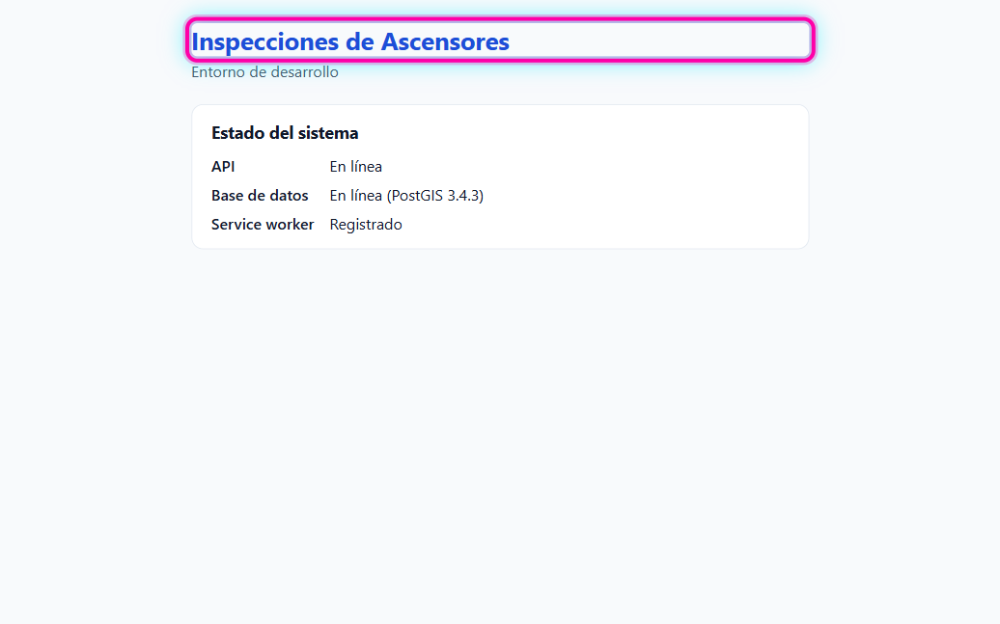
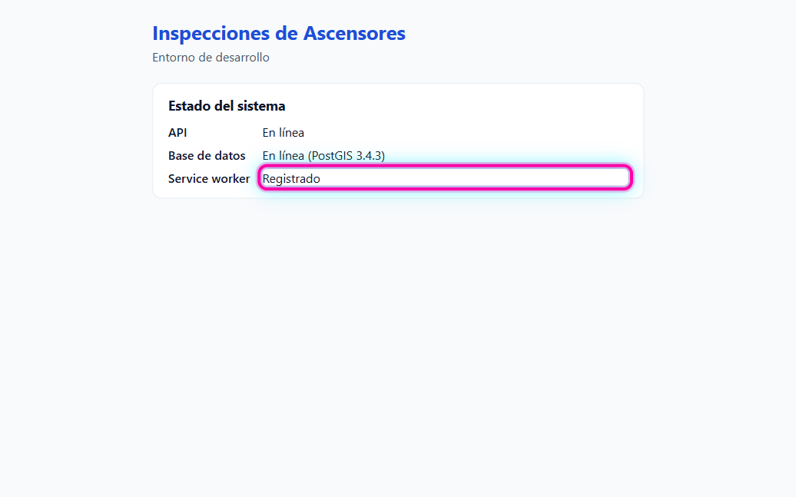
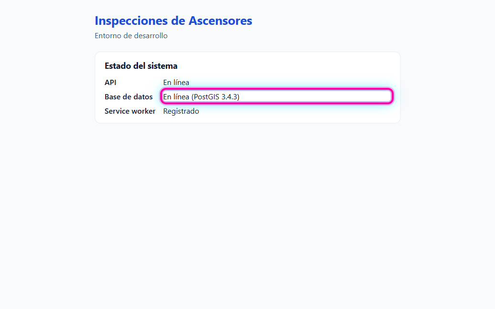

# RO-01 · Guía de pruebas — Setup del proyecto y entorno verificable

- **Tarea:** RO-01 / RF-01 — `REQ-1791560828605`
- 🌐 **Probar en:** https://localhost:8050
- **Entrega:** [RF-01-entrega.md](RF-01-entrega.md) · **Script:** [RF-01-entrega.sh](RF-01-entrega.sh)

## Condiciones previas

- Repo en la rama a probar (`dev` o `testing`), con `npm install` hecho.
- `.env` copiado de `.env.example`, `npm run certs` y **`mkcert -install`** hechos en esta máquina.
- `npm run db:up` y `npm run dev` corriendo.
- No hace falta usuario ni datos: todavía no hay login.

## Flujo probado



## Paso a paso en la pantalla (condiciones 1, 4 y 5)

### Paso 1 — Abrir la app

Abrir https://localhost:8050 en Chrome o Edge. El navegador **no** tiene que mostrar ninguna advertencia de certificado.

Se ve el título `Inspecciones de Ascensores`, el subtítulo `Entorno de desarrollo` y la tarjeta `Estado del sistema`.



### Paso 2 — Service worker registrado (condición 5)

En la tarjeta `Estado del sistema`, la fila `Service worker` dice `Registrado`. Puede mostrar `Verificando…` durante un segundo.



Comprobación adicional: F12 → `Application` → `Service workers` muestra `dev-sw.js?dev-sw` con estado `activated and is running`. Desde la consola (F12), `(await navigator.serviceWorker.getRegistrations())[0].active.state` devuelve `"activated"`.

Corrida del 05/11/2026 en Chrome 156 (Windows 11): 1 registro, `https://localhost:8050/dev-sw.js?dev-sw`, estado `activated`.

### Paso 3 — API y base en línea (condiciones 1 y 4)

En la misma tarjeta, la fila `API` dice `En línea` y la fila `Base de datos` dice `En línea (PostGIS 3.4.3)`. La versión puede variar en el último número.



## Comprobaciones por línea de comandos (condiciones 1 a 4)

Todas están automatizadas en el script de entrega:

```bash
bash docs/pruebas/ro-01-ro-01-setup-del-proyecto-y-ent/RF-01-entrega.sh
```

Resultado esperado (05/11/2026):

```
1. GET /api/health responde 200 con el estado de la API y de la base
  ✅ HTTP 200 · {"status":"ok","api":"ok","db":{"status":"ok","postgis":"3.4.3"}}
2. CORS: sólo el origen de Scrum recibe Access-Control-Allow-Origin
  ✅ Origin https://scrum.nuestrocamino.cloud → ACAO: https://scrum.nuestrocamino.cloud
  ✅ Origin https://sitio-ajeno.example → sin ACAO
  ✅ Preflight OPTIONS → 204 con ACAO
3. En producción la API no devuelve encabezados CORS
  ✅ NODE_ENV=production con CORS_ORIGINS cargado → 0 encabezados Access-Control-*
4. PostgreSQL + PostGIS levantado y /api/health informa la versión de PostGIS
  ✅ PostGIS 3.4.3
5. La app web carga y expone lo necesario para el service worker
  ✅ GET / → 200 con el título de la app
  ✅ manifest.webmanifest → 200
  ✅ service worker (dev-sw.js) → 200

== Resultado: 9 verificaciones OK, 0 fallidas
```

Para una sola comprobación a mano (Git Bash en Windows: agregar `--ssl-no-revoke`):

```bash
curl -s -D - -o /dev/null -H "Origin: https://scrum.nuestrocamino.cloud" https://localhost:8050/api/health | grep -i access-control
# → access-control-allow-origin: https://scrum.nuestrocamino.cloud
curl -s -D - -o /dev/null -H "Origin: https://sitio-ajeno.example" https://localhost:8050/api/health | grep -i access-control
# → (nada)
```
